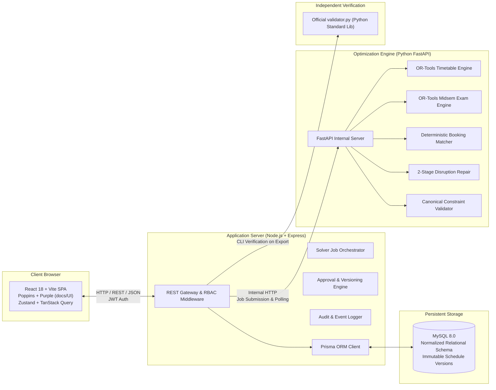
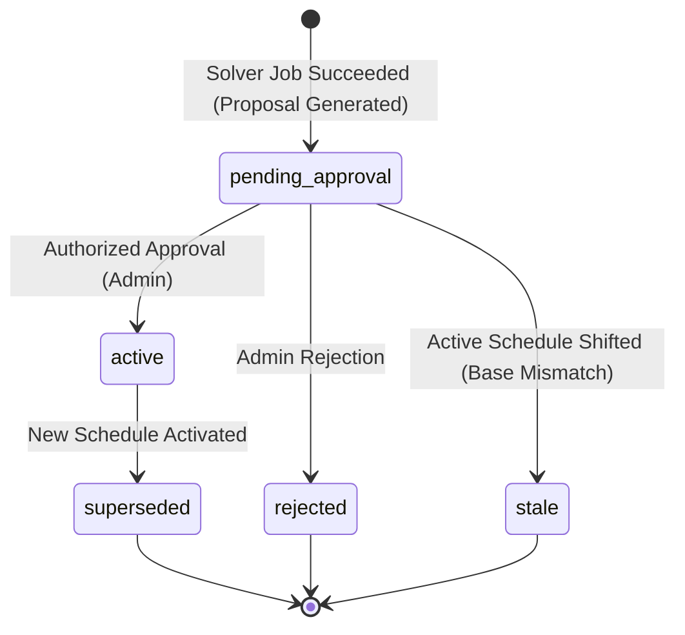
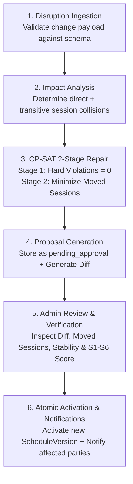

# 02 — Architecture, Service Boundaries & Lifecycle Execution

> **Status:** Canonical Specification  
> **Key Architecture Decisions:** Multi-service separation of concerns, single source of truth validation, immutable versioned schedules, optimistic concurrency control, and zero-error execution guarantees.

---

## 1. System Topology & Service Boundaries



---

## 2. Definitive Service Responsibility Matrix

To eliminate logic drift and ensure zero runtime errors, responsibilities are partitioned with strict structural boundaries:

| Layer | MUST Do | MUST NOT Do |
|---|---|---|
| **React SPA (`client/`)** | - Render responsive timetable, exam, booking, and disruption views.<br>- Display live drag-and-drop feedback (green/red slots) via debounced validation calls.<br>- Provide AI Copilot chat drawer with explicit editable JSON confirmation form.<br>- Fallback gracefully to manual forms on LLM failure.<br>- Copy typography and theme tokens from `docs/UI/app-ui`. | - Never compute final constraint validity.<br>- Never commit schedule mutations directly.<br>- Never store raw LLM API keys in browser bundle. |
| **Node.js Gateway (`server/`)** | - Authenticate users with JWT (Argon2id passwords).<br>- Enforce 4-role RBAC server-side (`admin`, `department_coordinator`, `faculty`, `club`).<br>- Manage job queue and poll Python solver asynchronously.<br>- Enforce optimistic locking and version integrity.<br>- Enforce "no self-approval" rule.<br>- Persist immutable proposals, active schedules, and append-only audit logs.<br>- Generate export files and execute official `validator.py`. | - Never execute CP-SAT constraint models in JavaScript.<br>- Never approve proposals without canonical validator clearance.<br>- Never allow raw LLM output to bypass JSON schema validation. |
| **Python Engine (`optimizer/`)** | - Execute OR-Tools CP-SAT discrete optimization.<br>- Run deterministic booking allocation and inversion prevention.<br>- Execute Canonical Constraint Validator matching `validator.py`.<br>- Provide detailed diagnostics on solver infeasibility or hard constraint failures.<br>- Return structured proposal JSON payloads to Node.js. | - Never write directly to MySQL database.<br>- Never initiate schedule activations or approvals.<br>- Never call LLM APIs directly. |
| **MySQL (`storage`)** | - Store relational records with foreign keys and unique constraints.<br>- Store immutable schedule versions and assignments.<br>- Store audit logs, disruption jobs, and user credentials. | - Never evaluate business logic or constraints. |

---

## 3. Core Lifecycle State Machines

### 3.1 Schedule Version Lifecycle
Schedules are strictly immutable. Once created, a `ScheduleVersion` is never updated in-place; all changes yield a new proposal version.



- **Invariant:** At any time $T$, exactly ONE `ScheduleVersion` holds status `active` for a given `DatasetVersion`.
- **Activation Transaction:**
  ```sql
  START TRANSACTION;
  -- 1. Ensure current active matches expected base_version_id (concurrency guard)
  SELECT id FROM ScheduleVersion WHERE status = 'active' AND dataset_version_id = ? FOR UPDATE;
  -- 2. Mark existing active as superseded
  UPDATE ScheduleVersion SET status = 'superseded' WHERE status = 'active' AND dataset_version_id = ?;
  -- 3. Mark proposed version as active
  UPDATE ScheduleVersion SET status = 'active', activated_at = NOW() WHERE id = ?;
  COMMIT;
  ```

### 3.2 Disruption Repair Lifecycle
Disruptions represent permanent changes to the academic calendar. They follow a controlled 6-stage pipeline:



---

## 4. Background Solver Job Orchestration

Long-running CP-SAT optimizations run asynchronously in the Python service. The Node.js server manages execution state via a database-backed job queue:

1. **Job Dispatch**: Node.js issues `POST /internal/solve/timetable` or `/internal/solve/disruption` to Python FastAPI.
2. **Immediate Acknowledgment**: Python spawns a background thread/process, creates a `job_id`, and immediately returns `{ "job_id": "...", "status": "queued" }`.
3. **Status Polling**: Node.js polls `GET /internal/jobs/:job_id` every 2000ms.
4. **Job States**:
   - `queued`: Waiting for available solver worker.
   - `running`: CP-SAT search active (reports elapsed time).
   - `succeeded`: Feasible solution found; returns full assignment payload, soft scores, and metrics.
   - `failed`: Infeasible constraints or internal error; returns relaxation suggestions and conflict analysis.
   - `timeout`: Solver reached configurable limit (default 300s).
5. **Persistence**: Node.js persists the completed proposal in MySQL as a new `ScheduleVersion` with status `pending_approval`.

---

## 5. Concurrency & Integrity Controls

### 5.1 Optimistic Concurrency Control
When approving a proposal (e.g. Disruption Repair or Spectra Overrides), the client submits `expected_base_version_id`. If another user or disruption activated a schedule in the interim:
- The transaction aborts with `HTTP 409 Conflict: BASE_SCHEDULE_STALE`.
- The UI displays a warning: *"A newer schedule has been activated. Please refresh and re-run optimization against the latest baseline."*

### 5.2 Server-Enforced "No Self-Approval" Rule
A critical enterprise governance control:
- An actor cannot approve their own booking request or override.
- An actor cannot approve a disruption proposal that they submitted.
- The approval endpoint verifies:
  $$\text{approver\_id} \ne \text{creator\_id}$$
- Attempted self-approval returns `HTTP 403 Forbidden: SELF_APPROVAL_PROHIBITED`.

### 5.3 Single Source of Truth Validation Gate
Before **ANY** schedule proposal moves from `pending_approval` to `active`, the Node.js server automatically passes the proposal payload through the Python Canonical Validator.
- If `hard_violation_count > 0`: **Activation is permanently blocked**.
- Error details with exact violation codes (H1–H14) are logged in the audit trail.

