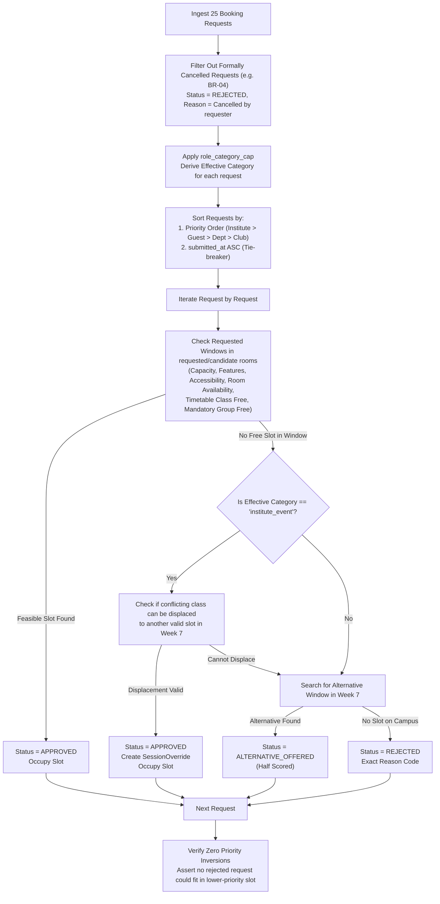

# 03 — Optimization Algorithms & Solver Specifications

> **Status:** Canonical Specification  
> **Engines Covered:** Weekly Timetable Solver (CP-SAT), Midsem Exam Scheduler (CP-SAT), Spectra Booking Decision Engine, Disruption Repair Solver (Multi-Objective).

---

## 1. Weekly Timetable Solver (OR-Tools CP-SAT)

The regular timetable generation problem is formulated as a discrete Constraint Satisfaction and Optimization Problem (COP) using Google OR-Tools CP-SAT.

### 1.1 Decision Variables & Domain Pruning
Let $S$ be the set of sessions, $D$ be teaching days (`MON`–`FRI`), $P$ be periods ($1 \le p \le 9$), and $R$ be rooms.

To prevent combinatorial explosion ($189 \times 5 \times 9 \times 27 \approx 230,000$ variables), we construct an admissible candidate set $\mathcal{C}(s) \subseteq D \times P \times R$ for each session $s$ via upfront pruning:
$$(d, p, r) \in \mathcal{C}(s) \iff \begin{cases}
r.capacity \ge s.size & \text{(H5 Capacity)} \\
r.type \in s.room\_types & \text{(H6 Room Type)} \\
\neg s.needs\_accessible \lor r.accessible & \text{(H10 Accessibility)} \\
p + s.duration - 1 \le 9 & \text{(H9 Upper Bound)} \\
\neg (p \le 5 < p + s.duration - 1) & \text{(H9 Lunch Exclusion)} \\
s.kind \ne \text{"lab"} \lor p \in \{2, 6\} & \text{(H9 Lab Start Slots)} \\
(d, p') \notin ctx.room\_un[r.id], \forall p' \in [p, p + s.duration - 1] & \text{(H8 Room Maintenance)} \\
(d, p') \notin ctx.fac\_un[s.faculty\_id], \forall p' \in [p, p + s.duration - 1] & \text{(H7 Faculty Leave)} \\
s.fixed\_slot == \text{null} \lor (d == s.fixed\_slot.day \land p == s.fixed\_slot.start\_period) & \text{(H14 Fixed Slots)}
\end{cases}$$

For each session $s$ and admissible $(d, p, r) \in \mathcal{C}(s)$, define a Boolean variable:
$$x_{s, d, p, r} \in \{0, 1\}$$

### 1.2 Hard Constraint Formulations (CP-SAT)

1. **Exact Assignment (H1):**
   $$\sum_{(d, p, r) \in \mathcal{C}(s)} x_{s, d, p, r} = 1 \quad \forall s \in S$$

2. **Room Collision Prevention (H4):**
   For each room $r$, day $d$, and period $t \in [1, 9]$:
   $$\sum_{s \in S} \sum_{\substack{(d, p, r) \in \mathcal{C}(s) \\ p \le t < p + s.duration}} x_{s, d, p, r} \le 1$$

3. **Faculty Collision Prevention (H2):**
   For each faculty member $f$, day $d$, and period $t \in [1, 9]$:
   $$\sum_{\substack{s \in S \\ s.faculty\_id = f}} \sum_{\substack{(d, p, r) \in \mathcal{C}(s) \\ p \le t < p + s.duration}} x_{s, d, p, r} \le 1$$

4. **Student Group Collision Prevention (H3):**
   For each student group $g$, day $d$, and period $t \in [1, 9]$:
   $$\sum_{\substack{s \in S \\ g \in s.groups \land s.basket\_slot == \text{null}}} \sum_{\substack{(d, p, r) \in \mathcal{C}(s) \\ p \le t < p + s.duration}} x_{s, d, p, r} + \sum_{b \in B} y_{b, d, t} \le 1$$
   *where $y_{b, d, t} = 1$ if elective basket $b$ occupies $(d, t)$.*

5. **Elective Basket Slot Synchronization (H11):**
   For all sessions $s_1, s_2$ belonging to the same basket slot $b$:
   $$\sum_{r} x_{s_1, d, p, r} = \sum_{r} x_{s_2, d, p, r} \quad \forall d \in D, p \in P$$
   *(All sessions in basket $b$ must be scheduled at the exact same day and start period, occupying distinct rooms).*

6. **Faculty Daily Teaching Limits (H12):**
   For each faculty member $f$ and day $d$:
   $$\sum_{\substack{s \in S \\ s.faculty\_id = f}} \sum_{(d, p, r) \in \mathcal{C}(s)} s.duration \cdot x_{s, d, p, r} \le f.max\_hours\_per\_day$$

### 1.3 Objective Function (Minimizing S1–S6)
$$\min \left( 2 \cdot S_1 + 1 \cdot S_2 + 3 \cdot S_3 + 3 \cdot S_4 + 1 \cdot S_5 + 1 \cdot S_6 \right)$$
- $S_1$: Linear sum of $x_{s, d, p, r}$ where $(d, p') \in \text{faculty avoided periods}$.
- $S_5$: Linear sum of $x_{s, d, p, r}$ where $\frac{s.size}{r.capacity} < 0.4$.
- $S_6$: Linear sum of $x_{s, d, p, r}$ where $p + s.duration - 1 = 9$.
- $S_2, S_3, S_4$: Linearized auxiliary integer variables capturing daily span gaps, excess daily hours, and repeated same-day lectures.

---

## 2. Midsem Examination Solver (OR-Tools CP-SAT)

The exam scheduler allocates 41 exams across 6 days (`MON`–`SAT`) and 2 daily sessions (`AM`, `PM`), yielding 12 total exam slots.

### 2.1 Variables & Formulation
Let $E$ be the set of midsem exams. Each exam $e \in E$ requires a slot $(d, t) \in \text{Days} \times \{AM, PM\}$ and a subset of rooms $R_e \subseteq R_{exam}$.

1. **Slot Assignment:** Boolean variable $z_{e, d, t} \in \{0, 1\}$.
   $$\sum_{d, t} z_{e, d, t} = 1 \quad \forall e \in E \quad \text{(E1 Completeness)}$$

2. **Room Assignment:** Boolean variable $w_{e, d, t, r} \in \{0, 1\}$ indicating exam $e$ uses room $r$ in slot $(d, t)$.
   $$w_{e, d, t, r} \le z_{e, d, t}$$

3. **Room Eligibility & Double-Booking (E2 & H4):**
   - $w_{e, d, t, r} = 0$ if `"exam" \notin r.allowed\_uses$.
   - For each room $r$ and slot $(d, t)$:
     $$\sum_{e \in E} w_{e, d, t, r} \le 1$$

4. **Half-Capacity Seating Requirement (H5):**
   $$\sum_{r} w_{e, d, t, r} \cdot \left\lfloor \frac{r.capacity}{2} \right\rfloor \ge e.size \cdot z_{e, d, t}$$

5. **Student Group Collision Prevention (H3):**
   For each group $g$ and slot $(d, t)$:
   $$\sum_{e \in E : g \in e.groups} z_{e, d, t} \le 1$$

6. **Exam Objective (Minimizing Multi-Exam Days):**
   Let $ex\_count_{g, d} = \sum_{t \in \{AM, PM\}} \sum_{e : g \in e.groups} z_{e, d, t}$.
   $$\min \sum_{g} \sum_{d} 5 \cdot \max(0, ex\_count_{g, d} - 1)$$

---

## 3. Spectra Week Booking Engine (Deterministic Matcher)

Because booking decisions require strict governance, role-capping, tie-breaking, and priority inversion prevention, they are solved via a deterministic matching algorithm.

### Inversion-Free Property Guarantee
Because requests are considered in strict `(effective_category, submitted_at)` order, any slot occupied by a lower-priority request was guaranteed to have been unavailable or unsuitable (insufficient capacity, missing features, or conflicting window) for every higher-priority request considered before it.

---

## 4. Disruption Repair Solver (2-Stage CP-SAT)

When a disruption file (e.g., `sample_disruption.json`) introduces room closures, faculty leaves, or session additions/deletions, the schedule must be repaired with **maximum stability**.

### 4.1 Cost Function & Movement Penalty
Unlike naive implementations that freeze unaffected sessions (causing infeasibility when domino relocations are needed), our 2-stage CP-SAT solver uses soft stability penalties:

$$\text{Stability Cost} = \sum_{s \in S_{base} \cap S_{after}} \left( 100 \cdot \mathbb{I}\left( (d_s, p_s) \ne (d_s^{base}, p_s^{base}) \right) + 10 \cdot \mathbb{I}\left( r_s \ne r_s^{base} \land (d_s, p_s) == (d_s^{base}, p_s^{base}) \right) \right)$$

- Moving a session to a **new time** incurs a heavy penalty (**100 points**).
- Moving a session to a **different room at the same time** incurs a mild penalty (**10 points**).
- Retaining original assignment incurs **0 points**.

### 4.2 Multi-Stage Execution
1. **Stage 1 (Feasibility Check):** Verify that a zero-hard-violation timetable exists on the mutated dataset.
2. **Stage 2 (Stability Optimization):**
   $$\min \left( \text{Stability Cost} + \frac{1}{10} \sum_{k=1}^6 S_k \right)$$
   This guarantees that the solver prioritizes keeping sessions in place, only moving sessions when strictly required to resolve hard conflicts.

