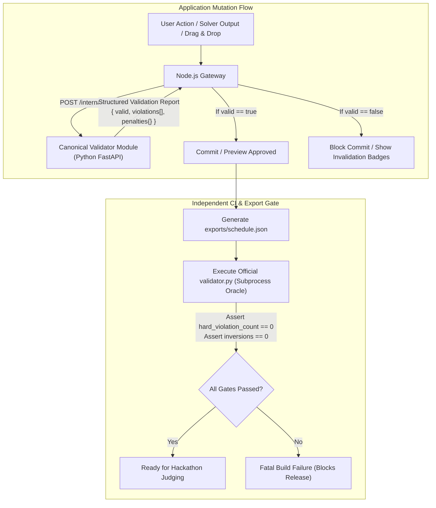

# 04 — Canonical Validator & Parity Test Harness

> **Status:** Canonical Specification  
> **Mandate:** Single source of truth for constraint evaluation. Zero divergence between application validation and official `validator.py`.

---

## 1. Dual-Layer Validation Architecture

To eliminate the discrepancy risks identified in `.kiro/gaps.md` (where Node.js and Python had differing constraint definitions), CIT CampusOS enforces a unified validation pipeline:



---

## 2. Standardized Reason Codes & Violation Taxonomy

Every hard violation, booking rejection, and exam conflict maps to a canonical reason code used across the frontend, API, and audit log:

| Code | Canonical Reason Code | Official Rule | Triggering Condition |
|---|---|:---:|---|
| `H1_UNSCHEDULED` | `SESSION_NOT_SCHEDULED` | H1 | A session from the dataset is omitted from the schedule. |
| `H1_UNKNOWN_SESSION` | `UNKNOWN_SESSION_ID` | H1 | A schedule entry references an unrecognized session ID. |
| `H1_DUPLICATE` | `SESSION_DUPLICATE_ASSIGNMENT`| H1 | A session appears multiple times in the schedule. |
| `H1_INVALID_DAY` | `INVALID_DAY_SPECIFIED` | H1 | Day is not in `calendar.days` (`MON`–`FRI`). |
| `H1_UNKNOWN_ROOM` | `UNKNOWN_ROOM_ID` | H1 | Room does not exist in `rooms` table. |
| `H2_FACULTY_CLASH` | `FACULTY_DOUBLE_BOOKED` | H2 | A faculty member is assigned to two sessions in the same period. |
| `H3_GROUP_CLASH` | `STUDENT_GROUP_DOUBLE_BOOKED` | H3 | A student group is assigned to two sessions/exams in the same period. |
| `H4_ROOM_CLASH` | `ROOM_DOUBLE_BOOKED` | H4 | A room is assigned to two sessions/exams/bookings in the same period. |
| `H5_CAPACITY` | `ROOM_CAPACITY_EXCEEDED` | H5 | Session size exceeds room capacity (or exam size exceeds half-capacity). |
| `H6_ROOM_TYPE` | `ROOM_TYPE_INCOMPATIBLE` | H6 | Room type is not in `session.room_types` (e.g. lab in classroom). |
| `H7_FACULTY_UNAVAIL`| `FACULTY_ON_LEAVE` | H7 | Session scheduled during faculty member's declared unavailable slot. |
| `H8_ROOM_UNAVAIL` | `ROOM_UNDER_MAINTENANCE` | H8 | Session scheduled during room's maintenance window. |
| `H9_BOUNDS` | `SESSION_OUTSIDE_TEACHING_HOURS`| H9 | Session runs outside periods 1–9. |
| `H9_LUNCH` | `SESSION_CROSSES_LUNCH` | H9 | Session spans across lunch break (between P5 and P6). |
| `H9_LAB_START` | `INVALID_LAB_START_PERIOD` | H9 | 3-hour lab session starts at a period other than P2 or P6. |
| `H10_ACCESSIBILITY` | `ACCESSIBILITY_REQUIRED` | H10 | Session requires accessible room, but room has `accessible: false`. |
| `H11_BASKET_SYNC` | `ELECTIVE_BASKET_DESYNC` | H11 | Sessions sharing an elective basket slot differ in day or start period. |
| `H12_FACULTY_LIMIT` | `FACULTY_DAILY_HOURS_EXCEEDED` | H12 | Faculty daily teaching hours exceed `faculty.max_hours_per_day`. |
| `H13_VENUE_EVENT` | `ROOM_CANNOT_HOST_EVENTS` | H13 | Room `allowed_uses` does not contain `"event"`. |
| `H13_VENUE_FEATURES`| `ROOM_LACKS_REQUIRED_FEATURES` | H13 | Room missing required features (`needs`) or accessibility. |
| `H13_GROUP_CONFLICT`| `BOOKING_MANDATORY_GROUP_CLASH`| H13 | Booking scheduled when a mandatory group has regular teaching classes. |
| `H14_FIXED_SLOT` | `FIXED_SLOT_VIOLATED` | H14 | Session with `fixed_slot` placed in an alternative slot. |
| `B1_DUPLICATE_DEC` | `DUPLICATE_BOOKING_DECISION` | B1 | More than one decision rendered for a single request. |
| `B2_OVERRIDE_AUTH` | `INVALID_SESSION_OVERRIDE` | B2 | Displacement attempted by a non-`institute_event` request. |
| `B3_CANCELLED` | `CANCELLED_REQUEST_APPROVED` | B3 | Approved or alternative offered for a formally cancelled request. |
| `E1_INVALID_EXAM` | `EXAM_SCHEDULE_ERROR` | E1 | Exam missing, duplicated, or placed outside `calendar.exam_week`. |
| `E2_EXAM_ROOM` | `ROOM_CANNOT_HOST_EXAMS` | E2 | Room assigned to exam lacks `"exam"` in `allowed_uses`. |

---

## 3. Python Canonical Validator Implementation Contract

The Python FastAPI internal service exposes:
`POST /internal/validate`

### 3.1 Request Payload
```json
{
  "dataset": { ...complete cit_public.json dataset... },
  "schedule": {
    "sessions": [ { "session_id": "MA101-AB-L1", "day": "MON", "start_period": 2, "room_id": "LH-1" } ],
    "fest_week": { "bookings": [ ... ], "session_overrides": [ ... ] },
    "exams": [ { "exam_id": "EX-MA101", "day": "MON", "session": "AM", "rooms": ["LH-1", "LH-2"] } ]
  },
  "baseline": { ...optional baseline schedule for disruption comparison... }
}
```

### 3.2 Response Payload
```json
{
  "valid": true,
  "hard_violation_count": 0,
  "hard_violations": [],
  "hard_by_rule": {},
  "soft_total": 42,
  "soft_penalties": {
    "S1": 4, "S2": 12, "S3": 0, "S4": 6, "S5": 14, "S6": 6
  },
  "bookings": {
    "booking_score": 58.5,
    "booking_score_max_if_all_approved": 64.0,
    "approved": 20,
    "alternatives": 2,
    "rejected": 3,
    "session_overrides": 1,
    "priority_inversions": []
  },
  "exam_soft_penalty": 0,
  "stability": {
    "sessions_moved": 3,
    "time_changed": 1,
    "room_only_changed": 2,
    "moved_ids": ["CS202-L1", "EE201-L2", "ME203-T1"]
  },
  "warnings": []
}
```

---

## 4. Parity Test Harness (Continuous Verification)

To prove that the internal validator never disagrees with the official judge's oracle, an automated test harness runs in CI:

```python
# tests/test_validator_parity.py
import json, subprocess
from optimizer.canonical_validator import validate_schedule

def test_full_parity_with_official_validator():
    with open("data/cit_public.json") as f:
        data = json.load(f)
    with open("exports/schedule.json") as f:
        sched = json.load(f)
    
    # 1. Run internal validator
    internal_report = validate_schedule(data, sched)
    
    # 2. Run official validator.py
    cmd = ["python", "validator.py", "--data", "data/cit_public.json", "--schedule", "exports/schedule.json", "--json", "tmp_oracle.json"]
    subprocess.run(cmd, check=True)
    with open("tmp_oracle.json") as f:
        oracle_report = json.load(f)
    
    # 3. Assert 100% field-by-field equality
    assert internal_report["hard_violation_count"] == oracle_report["hard_violation_count"] == 0
    assert internal_report["soft_total"] == oracle_report["soft_total"]
    assert internal_report["soft_penalties"] == oracle_report["soft_penalties"]
    assert internal_report["bookings"]["booking_score"] == oracle_report["bookings"]["booking_score"]
    assert len(internal_report["bookings"]["priority_inversions"]) == len(oracle_report["bookings"]["priority_inversions"]) == 0
```

