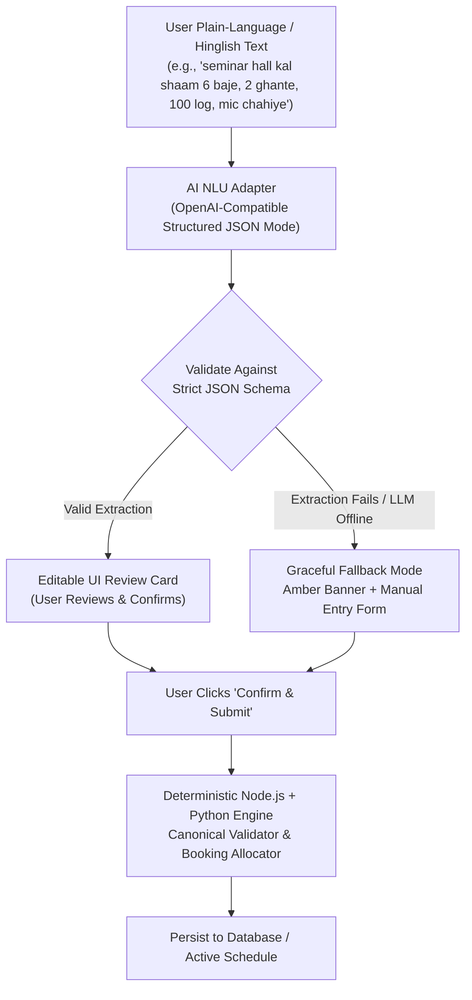

# 05 — AI Copilot & Graceful Fallback Architecture

> **Status:** Canonical Specification  
> **Mandate:** Natural language & Hinglish parsing, full P1–P13 temporal resolution, conditional booking handling, strict guardrails, and 100% resilient UI fallback.

---

## 1. Architectural Guardrails (AI Never Decides)

To ensure 100% accuracy and zero runtime errors, the AI layer is strictly sandboxed:



### Non-Negotiable AI Rules:
1. **No Direct DB Writes:** The AI adapter has read-only access to context; it has no database mutation privileges.
2. **No Constraint Adjudication:** The LLM never declares whether a room or slot is "valid" or "available". Availability is computed exclusively by the Python Canonical Validator.
3. **Reason Code Grounding:** When explaining rejections (e.g. why Dramatics was moved to the Auditorium), the AI Copilot must receive the code-generated reason string (e.g., `ROOM_OCCUPIED_BY_HIGHER_PRIORITY`) and only rephrase it for clarity without inventing facts.

---

## 2. NLU Extraction Schema & Temporal Resolution

The AI extraction service operates across the complete CIT operational calendar (**P1–P13**, not restricted to P1–P10):

### 2.1 Extraction JSON Schema
```json
{
  "type": "object",
  "properties": {
    "intent": { "type": "string", "enum": ["book_venue", "reschedule_session", "query_schedule"] },
    "title": { "type": ["string", "null"] },
    "attendance": { "type": ["integer", "null"], "minimum": 1, "maximum": 1500 },
    "duration_periods": { "type": ["integer", "null"], "minimum": 1, "maximum": 9 },
    "windows": {
      "type": "array",
      "items": {
        "type": "object",
        "properties": {
          "day": { "type": "string", "enum": ["MON", "TUE", "WED", "THU", "FRI", "SAT"] },
          "from_period": { "type": "integer", "minimum": 1, "maximum": 13 },
          "to_period": { "type": "integer", "minimum": 1, "maximum": 13 }
        },
        "required": ["day", "from_period", "to_period"]
      }
    },
    "room_types": {
      "type": "array",
      "items": { "type": "string", "enum": ["classroom", "lecture_hall", "auditorium", "seminar_hall", "outdoor", "lab_cs", "lab_elec", "lab_phy", "workshop", "lab_civil"] }
    },
    "needs": {
      "type": "array",
      "items": { "type": "string", "enum": ["projector", "pa_system", "stage", "ac", "computers", "power_benches", "accessible"] }
    },
    "requested_room": { "type": ["string", "null"] },
    "mandatory_for_groups": {
      "type": "array",
      "items": { "type": "string" }
    },
    "conditional_preferences": {
      "type": "array",
      "items": {
        "type": "object",
        "properties": {
          "priority": { "type": "integer" },
          "window": { "$ref": "#/properties/windows/items" },
          "preferred_room": { "type": ["string", "null"] }
        }
      }
    },
    "follow_up": { "type": ["string", "null"] }
  },
  "required": ["intent", "attendance", "duration_periods", "windows", "room_types", "needs"]
}
```

### 2.2 Hinglish & Temporal Slang Mappings
The parser deterministically resolves common Indian collegiate terminology:

| Input Phrase | Interpretation & Mapping | Target Periods |
|---|---|:---:|
| *"kal shaam 6 baje, 2 ghante"* | Next calendar weekday at 18:00 for 2 hours | Window: `from_period: 10, to_period: 11` |
| *"after lunch on Thursday"* | Thursday following lunch break (P5 ends at 13:00) | Window: `day: "THU", from_period: 6, to_period: 9` |
| *"coding contest 3 hours Thursday afternoon"* | Lab session needing CS Lab | `room_types: ["lab_cs"]`, `needs: ["computers"]`, `duration: 3`, P6–P8 |
| *"wheelchair accessible poster session"* | Accessibility requirement | `needs: ["accessible"]` |
| *"mic chahiye / speaker setup"* | Public address sound system | `needs: ["pa_system"]` |
| *"pro-night / star night"* | Large cultural festival event | `room_types: ["outdoor", "auditorium"]`, `needs: ["stage", "pa_system"]` |

### 2.3 Handling Conflicts & Contradictions (Sample Request 7)
If a user states: *"I want SH-2 on Friday at 10 am for a wheelchair-accessible poster session"*, the system recognizes that:
- `SH-2` has `accessible: false`.
- The user specified `accessible` in `needs`.
- **System Behavior:** Instead of silently dropping the accessibility requirement or booking inaccessible SH-2, the AI Copilot returns `requested_room: "SH-2"` with `needs: ["accessible"]` and presents a UI suggestion recommending `SH-1` (which is accessible and has identical capacity).

---

## 3. Conditional Requests (Extra Feature)

When users formulate fallback preferences (e.g. *"Book Auditorium Friday evening, else Saturday morning, or else SH-1"*):
- The AI extracts ordered preferences into `conditional_preferences`.
- The booking engine tests the primary window first.
- If primary is unavailable due to an institute event, it cascades automatically to alternative 2 before generating a generic fallback, ensuring user intent is respected.

---

## 4. Resilient UI Fallback & Error Handling

To ensure the application never crashes during live demonstrations or network partitions:
1. **Circuit Breaker & Timeout:** All LLM API calls have an aggressive 6.0-second timeout.
2. **Fallback Response:** If the LLM throws an error (quota exceeded, invalid JSON, timeout):
   ```json
   {
     "ai_available": false,
     "error": "LLM_SERVICE_UNAVAILABLE",
     "message": "AI Copilot is currently offline. You can proceed using the manual booking form."
   }
   ```
3. **UI State Transition:**
   - The chat interface displays an amber notification banner:  
     `⚠️ AI Copilot offline — manual entry form loaded below.`
   - The manual booking form is automatically presented with standard inputs for Venue, Day, Time, Capacity, and Equipment.
   - Zero workflow blockage occurs; the user submits their booking without noticing server-side AI degradation.

