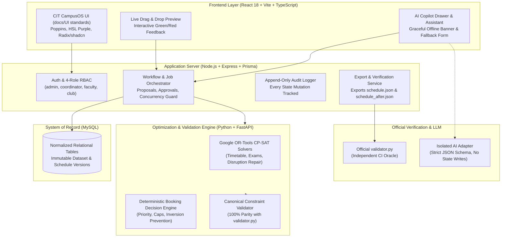

# CIT CampusOS — Master Specification & Engineering Blueprint

> **Authoritative Specification Directory:** `.antigravity/`  
> **Target Product:** CIT CampusOS (Campus Scheduling, Exam Planning, Venue Management & Disruption Engine)  
> **Source Documents Audited:**
> - Problem Statement PDF & Starter Pack (`README.md`, `cit_public.json`, `validator.py`)
> - Solution Documents (`docs/TowardsSoln/CIT_CampusOS_Documentation/`)
> - Gap Audits (`.kiro/gaps.md`, `.kiro/gaps-design.md`)
> - UI Standards & Reference Architecture (`docs/UI/app-ui`)

---

## 1. Executive Summary & Zero-Gap Objective

CIT CampusOS is a resilient, enterprise-grade operations platform designed for Chilika Institute of Technology (CIT) to solve four core campus operational challenges:
1. **Regular Weekly Timetable Generation**: 189 sessions (243 teaching hours) across 27 rooms, 40 faculty, and 14 student groups with **zero hard-constraint violations** and minimized soft penalties.
2. **Midsem Examination Scheduling**: 41 exams distributed across exam week (MON–SAT, AM/PM) at half room capacity without group or room conflicts.
3. **Spectra Week Venue Allocation (Fest Week / Week 7)**: 25 booking requests evaluated deterministically using role category caps, priority ordering, tie-breaking, and class displacement rules with **zero priority inversions**.
4. **Permanent Disruption & Rescheduling Engine**: Repair engine that absorbs faculty leaves, room closures, new sessions, and cancellations while minimizing schedule churn and maintaining zero hard violations.
5. **AI Copilot with Safe Fallback**: Plain-language and Hinglish booking interpreter with temporal slot resolution (P1–P13) and graceful offline fallback where application code remains the sole arbiter of validity.

### Resolution of Previous Gaps (.kiro Audit)
This specification eliminates every single flaw documented in `.kiro/gaps.md` and `.kiro/gaps-design.md`:
- **Correct Rule Taxonomy**: Enforces official rules **H1–H14**, **B1–B3**, **E1–E2**, and **S1–S6** with exact mathematical parity with `validator.py`.
- **Accurate Time Model**: Replaces erroneous P1–P10 bounds with the authentic CIT time model: **P1–P9 teaching (08:00–17:00), lunch after P5 (13:00–14:00), P10–P13 event-only (18:00–22:00)**, and exam week MON–SAT (AM: 09:30–11:30, PM: 14:00–16:00).
- **Single Canonical Validator**: Replaces divergent validators with an authoritative Python service consumed via internal typed APIs and tested against `validator.py`.
- **Dynamic Stability Optimization**: Eliminates rigid session locks during disruptions, adopting a multi-stage objective that minimizes moved sessions (`time_changed` heavily weighted over `room_only_changed`).
- **Complete Booking Logic**: Implements deterministic category capping (`role_category_cap`), priority inversion detection, cancellation handling, and session override permissions.
- **Reference UI Implementation**: Adopts the exact typography (Poppins + Plus Jakarta Sans), HSL design tokens (purple primary `hsl(272 81% 56%)`), component library (Radix/shadcn), and layout patterns from `docs/UI/app-ui`.

---

## 2. Specification Directory Structure

| Specification File | Focus Area |
|---|---|
| [01_DOMAIN_RULES_AND_EXACT_CONSTRAINTS.md](file:///d:/Project%20files/Hackathons/TZ/.antigravity/01_DOMAIN_RULES_AND_EXACT_CONSTRAINTS.md) | Domain entities, time model, official H1–H14/B1–B3/E1–E2/S1–S6 constraints, booking priority calculus, scoring formulas |
| [02_ARCHITECTURE_AND_EXECUTION_FLOW.md](file:///d:/Project%20files/Hackathons/TZ/.antigravity/02_ARCHITECTURE_AND_EXECUTION_FLOW.md) | Multi-service architecture, service boundaries, proposal-approval state machine, background job orchestrator, concurrency control |
| [03_OPTIMIZATION_AND_SOLVER_SPEC.md](file:///d:/Project%20files/Hackathons/TZ/.antigravity/03_OPTIMIZATION_AND_SOLVER_SPEC.md) | Google OR-Tools CP-SAT formulation, timetable solver, exam solver, Spectra booking matcher, 2-stage disruption solver |
| [04_CANONICAL_VALIDATOR_AND_TEST_HARNESS.md](file:///d:/Project%20files/Hackathons/TZ/.antigravity/04_CANONICAL_VALIDATOR_AND_TEST_HARNESS.md) | Canonical validator architecture, parity harness against `validator.py`, reason codes, test matrix, CI oracle |
| [05_AI_COPILOT_AND_SAFE_FALLBACK.md](file:///d:/Project%20files/Hackathons/TZ/.antigravity/05_AI_COPILOT_AND_SAFE_FALLBACK.md) | NLU extraction schemas, Hinglish/temporal parser, conditional requests, guardrails, graceful UI fallback |
| [06_UI_UX_DESIGN_SYSTEM_AND_COMPONENTS.md](file:///d:/Project%20files/Hackathons/TZ/.antigravity/06_UI_UX_DESIGN_SYSTEM_AND_COMPONENTS.md) | UI standards derived from `docs/UI/app-ui`, typography, color tokens, layout, drag-and-drop live validation, diff viewer |
| [07_DATABASE_API_AND_RBAC_SPEC.md](file:///d:/Project%20files/Hackathons/TZ/.antigravity/07_DATABASE_API_AND_RBAC_SPEC.md) | Complete Prisma schema, REST API contracts, 4-role RBAC matrix, audit log schemas, demo reset pipeline |

---

## 3. High-Level System Architecture

---

## 4. Judging Rubric Alignment

| Rubric Area | Max Marks | Our Implementation Guarantee |
|---|:---:|---|
| **Scheduling Correctness** | 25 | **0 Hard Violations**: 100% compliance across H1–H14, E1–E2, and B1–B3 verified by official `validator.py`. |
| **Rescheduling / Disruption** | 15 | **Minimal Churn**: Multi-objective CP-SAT repair penalizing `time_changed` (10x) vs `room_only_changed` (1x). |
| **Use of AI** | 15 | **Robust Copilot**: Handles complex Hinglish, temporal slots (P1–P13), conditional requests, with 100% resilient UI fallback. |
| **Booking Decisions** | 10 | **Fair & Inversion-Free**: Strict role-capping, tie-breaking, override gating for institute events, and 0 inversions. |
| **Optimization Quality** | 10 | **Minimized Penalties**: Global search minimizing S1 (faculty prefs), S2 (gaps), S3 (workload), S4 (repeats), S5 (utilization), S6 (P9). |
| **UI & Usability** | 10 | **Enterprise Polish**: Exact match with `docs/UI/app-ui`, live drag-and-drop validation, interactive diffs, multi-role views. |
| **Code & Documentation** | 5 | **Flawless Delivery**: Fully documented, reproducible seed scripts, reset-demo-data endpoint, and clean commit history. |
| **Total** | **90** | **Target: 90 / 90 (First Place Engineering Standard)** |

