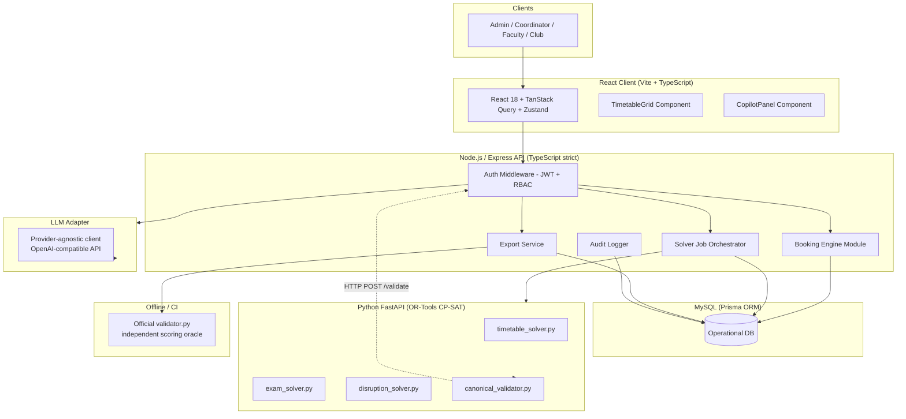
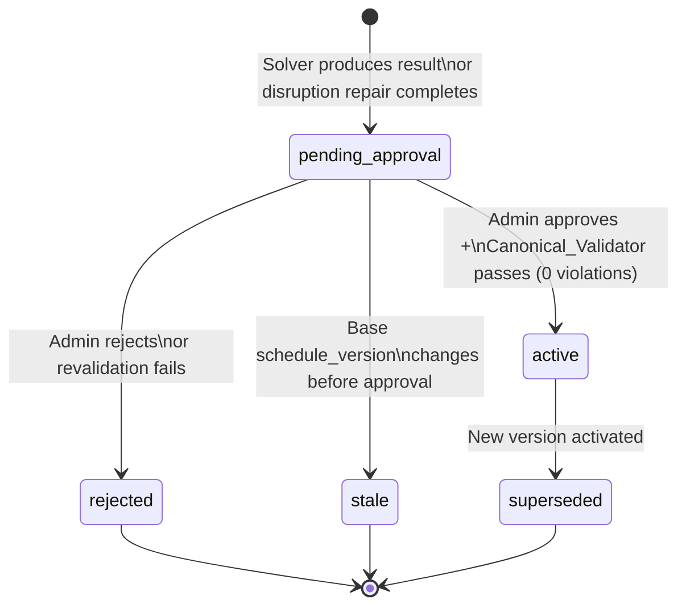
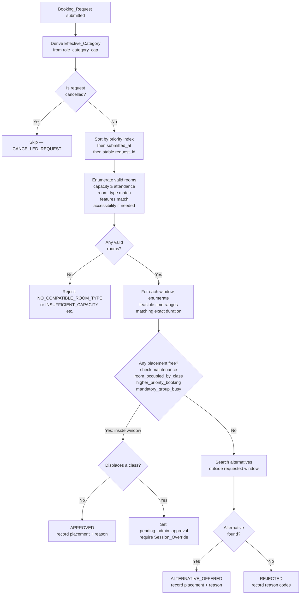
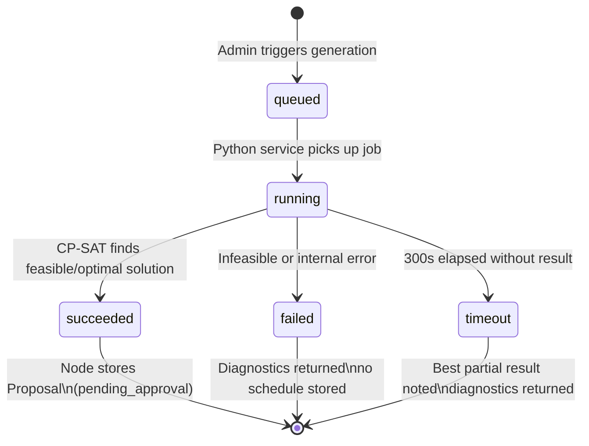

# Design Document

## CIT CampusOS — Constraint-Driven Campus Operations Platform

---

## Overview

CIT CampusOS is a multi-service web application for Chilika Institute of Technology that unifies four constraint-driven campus operations: weekly timetable generation, midsem exam scheduling, Spectra Week venue booking, and disruption-driven timetable repair. A natural-language AI copilot helps users compose requests without ever acting as a scheduling authority. Every constraint check flows through a single canonical validator, ensuring the application and the official `validator.py` scoring oracle are always in agreement.

The system is built for the Crunch Week / TZ Hackathon and must produce zero hard-constraint violations on the public dataset export while minimizing soft penalties. Judges run the official `validator.py` independently; the application runs the same validator as a subprocess on every export to surface any discrepancy before submission.

**Core design principles:**
- The optimizer never writes to the database; it returns proposals that the Node API validates, stores, and publishes only after authorized approval.
- Schedule versions are immutable; the active schedule is a pointer, never mutable rows.
- One canonical validator module is shared by all code paths — solver, manual move, drag/drop preview, AI proposals, and export verification.
- The AI copilot is structurally prevented from approving bookings, overriding capacity, or writing to any data store.

---

## Architecture

### System Architecture



### Service Boundaries

| Service | Responsibility | What it does NOT do |
|---|---|---|
| React client | Render, user interaction, polling, editable forms | Validate constraints, trust UI state for schedule truth |
| Node.js/Express | Auth, RBAC, workflow orchestration, booking engine, approvals, audit, exports | Run CP-SAT, call LLM directly |
| Python FastAPI | CP-SAT modeling, canonical constraint validation | Write to MySQL, approve proposals, call LLM |
| LLM Adapter | Parse free text → structured JSON, rephrase machine-generated reasons | Decide validity, approve bookings, invent facts |
| MySQL (Prisma) | Persistent system of record | Compute constraint violations |

### Inter-Service Communication

- **Node → Python (solver jobs):** Node posts a job payload to `POST /internal/solve/timetable` (or `/exams`, `/disruption`). Python returns a job ID immediately. Node polls `GET /internal/jobs/:id` every 2 seconds. Python writes result JSON to a temp path; Node reads it and stores as a `schedule_version`.
- **Node → Python (validation):** Node calls `POST /internal/validate` with a `ValidationContext` payload and receives a `ValidationResult` synchronously. This is used for every manual move, drag/drop preview, and approval revalidation.
- **Node → LLM Adapter:** Internal module call (no separate service); wrapped in a timeout + circuit-breaker. On failure, returns `{ ai_available: false }` to the client.
- **Export validation:** `GET /api/v1/exports/schedule.json` triggers `child_process.execFile('python', ['validator.py', ...])` in a controlled server environment after constructing the export from DB state.

### Schedule Version Lifecycle



### Booking Decision Pipeline



### Solver Job Lifecycle



---

## Components and Interfaces

### Frontend Component Tree

```
src/
├── pages/
│   ├── LoginPage
│   ├── DashboardPage (Command Center)
│   ├── TimetablePage  (group/faculty/room tabs)
│   ├── ExamsPage
│   ├── BookingsPage   (Spectra venue management)
│   ├── DisruptionsPage (Change Control)
│   ├── CopilotPage
│   ├── AdminPage      (import / export / reset)
│   └── AuditPage
├── components/
│   ├── layout/
│   │   ├── Sidebar            — deep navy (#0f172a), role-filtered nav links
│   │   ├── TopBar             — notifications bell, user menu
│   │   └── PageShell          — consistent padding + breadcrumb
│   ├── timetable/
│   │   ├── TimetableGrid      — Mon–Fri columns × P1–P9 rows
│   │   ├── SessionCard        — color by kind (lecture/tutorial/lab), draggable
│   │   ├── SlotDropZone       — drag target; calls validate-move before drop
│   │   ├── TimetableFilters   — group / faculty / room selector
│   │   └── ViolationBadge     — red badge with HC code tooltip
│   ├── bookings/
│   │   ├── BookingForm        — manual structured form
│   │   ├── BookingList        — table with status chips (green/amber/red)
│   │   ├── BookingDecisionCard — reason code + placement details
│   │   └── RoomCalendar       — Week 7 room occupancy grid
│   ├── disruptions/
│   │   ├── DisruptionDiff     — side-by-side old vs new assignments
│   │   ├── ApprovalCard       — approve/reject with concurrency warning
│   │   └── ImpactSummary      — moved/added/removed counts + affected entities
│   ├── copilot/
│   │   ├── CopilotPanel       — chat-like input area
│   │   ├── ExtractionForm     — editable prefilled form from LLM output
│   │   └── ConflictWarning    — surface incompatibility before submit
│   ├── exams/
│   │   ├── ExamGrid           — day × AM/PM matrix
│   │   └── ExamCapacityAlert  — flag where capacity < exam size
│   └── ui/                    — shadcn/ui base components (Button, Dialog, etc.)
├── hooks/
│   ├── useSolverJob           — polls GET /solver-jobs/:id every 2s
│   ├── useValidateMove        — debounced POST /schedules/validate-move
│   ├── useNotifications       — polls GET /notifications
│   └── useTimetableFilters    — persists filter state in Zustand
├── stores/
│   ├── uiStore.ts             — sidebar open, copilot panel, selected filters
│   ├── authStore.ts           — current user, role, department scope
│   └── jobStore.ts            — active solver job IDs, progress
└── services/
    ├── apiClient.ts           — axios instance with JWT cookie + interceptors
    └── queryKeys.ts           — TanStack Query key factory
```

### Key API Endpoints (Node.js/Express)

| Method | Path | Role | Description |
|---|---|---|---|
| POST | /api/v1/auth/login | public | Issue JWT HTTP-only cookie |
| POST | /api/v1/auth/logout | any | Invalidate session |
| GET | /api/v1/auth/me | any | Return authenticated user |
| POST | /api/v1/datasets/import | Admin | Import + validate dataset JSON |
| GET | /api/v1/datasets/active | Admin | Active dataset metadata |
| POST | /api/v1/admin/demo-reset | Admin | Restore clean demo state |
| POST | /api/v1/schedules/generate | Admin | Start timetable solver job |
| GET | /api/v1/solver-jobs/:jobId | Admin | Poll job status/progress |
| GET | /api/v1/schedules/active | auth | Active schedule version |
| POST | /api/v1/schedules/validate-move | auth | Preview move (no write) |
| POST | /api/v1/schedules/manual-move | Admin/Coord | Commit manual move |
| POST | /api/v1/schedules/:versionId/publish | Admin | Activate proposal |
| POST | /api/v1/exams/generate | Admin | Start exam solver job |
| GET | /api/v1/exams/schedule/:versionId | auth | Exam schedule |
| POST | /api/v1/bookings | auth | Submit booking request |
| GET | /api/v1/bookings | auth (scoped) | List bookings by role |
| POST | /api/v1/bookings/:id/cancel | requester | Cancel booking |
| POST | /api/v1/bookings/:id/decide | Admin | Approve/reject booking |
| POST | /api/v1/disruptions | Admin | Submit disruption change file |
| POST | /api/v1/disruptions/:id/solve | Admin | Start disruption repair job |
| GET | /api/v1/disruptions/:id/diff | Admin | View session diff |
| POST | /api/v1/disruptions/:id/approve | Admin | Approve repair proposal |
| POST | /api/v1/assistant/interpret-booking | auth | LLM parse free text |
| POST | /api/v1/assistant/interpret-change | Faculty | LLM parse session change |
| POST | /api/v1/assistant/explain-decision | auth | LLM rephrase machine reasons |
| GET | /api/v1/exports/schedule.json | Admin | Generate + validate export |
| GET | /api/v1/exports/schedule_after.json | Admin | Generate disruption export |
| GET | /api/v1/notifications | auth | List unread notifications |
| PATCH | /api/v1/notifications/:id/read | auth | Mark notification read |
| GET | /api/v1/audit | Admin | Paginated audit log |
| GET | /api/v1/dashboard/summary | auth | Violations count, job status, pending items |

### Python FastAPI Endpoints (internal)

| Method | Path | Description |
|---|---|---|
| POST | /internal/solve/timetable | Start timetable CP-SAT job; returns `{ job_id }` |
| POST | /internal/solve/exams | Start exam CP-SAT job |
| POST | /internal/solve/disruption | Start disruption repair job |
| GET | /internal/jobs/:jobId | Poll job status; returns progress + result ref |
| POST | /internal/validate | Synchronous canonical validation; returns `ValidationResult` |
| GET | /internal/health | Liveness check |

---

## Data Models

### Prisma Schema (MySQL)

```prisma
// Users and auth
model User {
  id                String          @id @default(cuid())
  email             String          @unique
  passwordHash      String
  role              Role
  department        String?
  facultyExternalId String?
  active            Boolean         @default(true)
  createdAt         DateTime        @default(now())
  updatedAt         DateTime        @updatedAt
  auditLogs         AuditLog[]
  approvals         Approval[]
  notifications     Notification[]
}

enum Role {
  admin
  department_coordinator
  faculty
  club_representative
}

// Immutable dataset snapshots
model DatasetVersion {
  id            String    @id @default(cuid())
  datasetId     String
  version       String
  sourceHash    String    @unique
  sourceJson    Json
  importedBy    String
  createdAt     DateTime  @default(now())
  isActive      Boolean   @default(false)
  rooms         Room[]
  faculty       Faculty[]
  studentGroups StudentGroup[]
  courses       Course[]
  sessions      Session[]
  bookingRequests BookingRequest[]
  exams         Exam[]
  scheduleVersions ScheduleVersion[]
}

model Room {
  id               String         @id @default(cuid())
  datasetVersionId String
  externalId       String
  name             String
  building         String
  type             String
  capacity         Int
  accessible       Boolean
  featuresJson     Json
  allowedUsesJson  Json
  datasetVersion   DatasetVersion @relation(fields: [datasetVersionId], references: [id])
  unavailability   RoomUnavailability[]
  @@unique([datasetVersionId, externalId])
}

model RoomUnavailability {
  id         String @id @default(cuid())
  roomId     String
  day        String
  periodsJson Json
  reason     String?
  room       Room   @relation(fields: [roomId], references: [id])
}

model Faculty {
  id               String         @id @default(cuid())
  datasetVersionId String
  externalId       String
  name             String
  department       String
  maxHoursPerDay   Int
  needsAccessible  Boolean
  preferencesJson  Json
  datasetVersion   DatasetVersion @relation(fields: [datasetVersionId], references: [id])
  unavailability   FacultyUnavailability[]
  @@unique([datasetVersionId, externalId])
}

model FacultyUnavailability {
  id         String  @id @default(cuid())
  facultyId  String
  day        String
  periodsJson Json
  reason     String?
  faculty    Faculty @relation(fields: [facultyId], references: [id])
}

model StudentGroup {
  id               String         @id @default(cuid())
  datasetVersionId String
  externalId       String
  name             String
  year             Int
  department       String
  size             Int
  needsAccessible  Boolean
  datasetVersion   DatasetVersion @relation(fields: [datasetVersionId], references: [id])
  @@unique([datasetVersionId, externalId])
}

model Course {
  id               String         @id @default(cuid())
  datasetVersionId String
  externalId       String
  title            String
  department       String
  year             Int
  metadataJson     Json
  datasetVersion   DatasetVersion @relation(fields: [datasetVersionId], references: [id])
  @@unique([datasetVersionId, externalId])
}

model Session {
  id               String         @id @default(cuid())
  datasetVersionId String
  externalId       String
  courseExternalId String
  kind             String         // lecture | tutorial | lab
  facultyExternalId String
  size             Int
  duration         Int
  roomTypesJson    Json
  needsAccessible  Boolean
  basketSlot       String?
  fixedSlotJson    Json?
  datasetVersion   DatasetVersion @relation(fields: [datasetVersionId], references: [id])
  sessionGroups    SessionGroup[]
  @@unique([datasetVersionId, externalId])
}

model SessionGroup {
  id              String  @id @default(cuid())
  sessionId       String
  groupExternalId String
  session         Session @relation(fields: [sessionId], references: [id])
}

// Immutable schedule versions
model ScheduleVersion {
  id               String         @id @default(cuid())
  datasetVersionId String
  parentVersionId  String?
  status           ScheduleStatus @default(pending_approval)
  solverConfigJson Json?
  hardViolationCount Int          @default(0)
  softScore        Int            @default(0)
  createdBy        String
  approvedBy       String?
  createdAt        DateTime       @default(now())
  activatedAt      DateTime?
  datasetVersion   DatasetVersion @relation(fields: [datasetVersionId], references: [id])
  assignments      ScheduleAssignment[]
  examAllocations  ExamAllocation[]
  sessionOverrides SessionOverride[]
  disruptionJobs   DisruptionJob[]
}

enum ScheduleStatus {
  pending_approval
  active
  superseded
  rejected
}

model ScheduleAssignment {
  id                String          @id @default(cuid())
  scheduleVersionId String
  sessionExternalId String
  day               String
  startPeriod       Int
  roomExternalId    String
  scheduleVersion   ScheduleVersion @relation(fields: [scheduleVersionId], references: [id])
  @@unique([scheduleVersionId, sessionExternalId])
}

model Exam {
  id               String         @id @default(cuid())
  datasetVersionId String
  externalId       String
  metadataJson     Json           // groups[], size, duration_hours, course_ids[]
  datasetVersion   DatasetVersion @relation(fields: [datasetVersionId], references: [id])
  allocations      ExamAllocation[]
  @@unique([datasetVersionId, externalId])
}

model ExamAllocation {
  id                String          @id @default(cuid())
  scheduleVersionId String
  examExternalId    String
  day               String
  examSession       String          // AM | PM (read from dataset)
  roomsJson         Json            // [room_external_id, ...]
  scheduleVersion   ScheduleVersion @relation(fields: [scheduleVersionId], references: [id])
}

// Booking engine
model BookingRequest {
  id               String         @id @default(cuid())
  datasetVersionId String
  externalId       String
  requester        String
  role             String
  requestedCategory String
  effectiveCategory String?
  submittedAt      DateTime
  rawText          String?
  payloadJson      Json
  status           BookingStatus  @default(pending)
  datasetVersion   DatasetVersion @relation(fields: [datasetVersionId], references: [id])
  decision         BookingDecision?
  @@unique([datasetVersionId, externalId])
}

enum BookingStatus {
  pending
  approved
  rejected
  alternative_offered
  cancelled
  pending_admin_approval
}

model BookingDecision {
  id              String         @id @default(cuid())
  bookingRequestId String        @unique
  decisionStatus  String         // approved | rejected | alternative_offered
  day             String?
  startPeriod     Int?
  endPeriod       Int?
  roomExternalId  String?
  reasonCode      String?
  reasonText      String?
  decidedBy       String
  decidedAt       DateTime
  bookingRequest  BookingRequest @relation(fields: [bookingRequestId], references: [id])
}

model SessionOverride {
  id                        String          @id @default(cuid())
  scheduleVersionId         String
  sessionExternalId         String
  day                       String
  startPeriod               Int
  roomExternalId            String
  displacedByRequestExtId   String
  scheduleVersion           ScheduleVersion @relation(fields: [scheduleVersionId], references: [id])
}

// Disruption engine
model DisruptionJob {
  id                    String          @id @default(cuid())
  baseScheduleVersionId String
  changePayloadJson     Json
  status                JobStatus       @default(queued)
  resultVersionId       String?
  diagnosticsJson       Json?
  createdBy             String
  approvedBy            String?
  createdAt             DateTime        @default(now())
  baseScheduleVersion   ScheduleVersion @relation(fields: [baseScheduleVersionId], references: [id])
  diffs                 ScheduleDiff[]
}

enum JobStatus {
  queued
  running
  succeeded
  failed
  timeout
}

model ScheduleDiff {
  id                String       @id @default(cuid())
  disruptionJobId   String
  sessionExternalId String
  oldAssignmentJson Json?
  newAssignmentJson Json?
  changeType        String       // moved | added | removed
  disruptionJob     DisruptionJob @relation(fields: [disruptionJobId], references: [id])
}

// Solver jobs (timetable + exam)
model SolverJob {
  id               String    @id @default(cuid())
  jobType          String    // timetable | exam | disruption
  status           JobStatus @default(queued)
  stage            String?
  progress         Int       @default(0)
  resultVersionId  String?
  errorDetails     String?
  solverVersion    String?
  seed             Int?
  datasetHash      String?
  solverParamsJson Json?
  objectiveScore   Int?
  createdAt        DateTime  @default(now())
  updatedAt        DateTime  @updatedAt
}

// Governance
model Approval {
  id            String   @id @default(cuid())
  subjectType   String   // schedule_version | disruption_job | booking_request
  subjectId     String
  requestedBy   String
  approverId    String?
  status        String   // pending | approved | rejected
  decisionNote  String?
  decidedAt     DateTime?
  approver      User?    @relation(fields: [approverId], references: [id])
}

model AuditLog {
  id           String   @id @default(cuid())
  actorUserId  String
  action       String
  entityType   String
  entityId     String
  beforeJson   Json?
  afterJson    Json?
  reason       String?
  requestId    String?
  createdAt    DateTime @default(now())
  actor        User     @relation(fields: [actorUserId], references: [id])
}

model Notification {
  id        String    @id @default(cuid())
  userId    String
  type      String
  payloadJson Json
  readAt    DateTime?
  createdAt DateTime  @default(now())
  user      User      @relation(fields: [userId], references: [id])
}
```

### Key Database Constraints

- `@@unique([datasetVersionId, externalId])` on all dataset entities — prevents cross-version collisions and detects duplicate IDs during import.
- `@@unique([scheduleVersionId, sessionExternalId])` on `ScheduleAssignment` — enforces HC-01 at the storage layer.
- `ScheduleVersion.status` transitions are enforced by application code; the DB records the final state but state machine logic lives in the Node service layer.
- The active schedule is identified by `ScheduleVersion.status = active` (at most one per dataset version). Activation atomically sets the new version to `active` and the previous one to `superseded` within a Prisma transaction.

---

## Correctness Properties

*A property is a characteristic or behavior that should hold true across all valid executions of a system — essentially, a formal statement about what the system should do. Properties serve as the bridge between human-readable specifications and machine-verifiable correctness guarantees.*

### Property 1: Dataset import rejection completeness

*For any* dataset JSON that contains at least one malformed record, missing required field, invalid reference, or duplicate external ID, the import SHALL be rejected and the response SHALL include at least one error entry whose path identifies the offending field or record.

**Validates: Requirements 1.2**

---

### Property 2: Import idempotence

*For any* valid dataset JSON, importing it a second time when the same content hash already exists SHALL result in exactly one `DatasetVersion` record in the database — not two.

**Validates: Requirements 1.4**

---

### Property 3: Schedule hard constraint — no double-booked room

*For any* published `ScheduleVersion`, no two `ScheduleAssignment` rows may share the same `(roomExternalId, day, startPeriod..startPeriod+duration-1)` range.

**Validates: Requirements 2.6**

---

### Property 4: Schedule hard constraints — faculty, group, capacity, type, accessibility, lunch, fixed slot

*For any* published `ScheduleVersion`, every assignment satisfies all of the following simultaneously:
- No faculty appears in two assignments with overlapping day+period range (HC-02)
- No student group appears in two non-basket assignments with overlapping day+period range (HC-03)
- Basket sessions with the same `basket_slot` share day+startPeriod and occupy distinct rooms (HC-04)
- `room.capacity >= session.size` (HC-06)
- `session.roomTypes` contains the assigned room's type (HC-07)
- The assigned day+periods do not appear in the faculty's unavailability (HC-08)
- The assigned day+periods do not appear in the room's unavailability (HC-09)
- No session spans the P5/P6 lunch break; lab sessions start only at P2 or P6; all sessions are within P1–P9 (HC-10)
- When `session.needsAccessible = true` or any group in the session has `needsAccessible = true`, the assigned room has `accessible = true` (HC-11)
- The sum of session durations assigned to a faculty member on any single day does not exceed that faculty's `maxHoursPerDay` (HC-12)
- Sessions with a `fixedSlot` attribute are placed at exactly that day and startPeriod (HC-13)

**Validates: Requirements 2.2, 2.3, 2.4, 2.5, 2.6, 2.7, 2.8, 2.9, 2.10, 2.11, 2.12, 2.13, 2.14**

---

### Property 5: Booking engine never approves a cancelled request

*For any* set of booking requests that includes one or more cancelled entries, the booking engine's output SHALL contain no `approved` or `alternative_offered` decision for any request whose `request_id` appears in the cancellations list.

**Validates: Requirements 5.3**

---

### Property 6: Effective category is always the less-privileged of requested and cap

*For any* booking request with a given `role` and `requestedCategory`, the computed `effectiveCategory` in the stored `BookingRequest` SHALL be whichever category appears later (farther down) in the `priority_order` list: the `requestedCategory` or the `role_category_cap` value for that role.

**Validates: Requirements 5.1**

---

### Property 7: No priority inversion in booking decisions

*For any* set of booking decisions, there SHALL be no pair of requests (A, B) where A has higher effective priority than B (earlier position in priority order, or same position with earlier `submitted_at`), B is `approved` or `alternative_offered`, and A is `rejected` — when A could have been assigned to a room/time that B holds.

**Validates: Requirements 5.9**

---

### Property 8: Disruption repair does not move unaffected sessions

*For any* disruption change file that makes a set S of sessions infeasible (directly or transitively), every session not in S SHALL retain its original `(day, startPeriod, roomExternalId)` in the repaired schedule, provided a valid assignment still exists for it.

**Validates: Requirements 6.6**

---

### Property 9: Canonical Validator returns all violations, not only the first

*For any* schedule that contains N ≥ 2 distinct hard constraint violations (injected with known codes), the `Canonical_Validator` SHALL return a `violations` array containing all N violations — not a proper subset.

**Validates: Requirements 17.3**

---

### Property 10: Canonical Validator is deterministic

*For any* `ValidationContext` input, calling `Canonical_Validator` twice with the identical input SHALL produce identical `ValidationResult` outputs (same `valid`, same `violations` set, same `warnings` set).

**Validates: Requirements 17.1, 17.3, 17.5**

---

### Property 11: CIT Copilot output never contains forbidden fields

*For any* free-text input submitted to the CIT Copilot, the structured JSON returned by the LLM extraction step SHALL NOT contain any of the keys: `effective_category`, `is_valid`, `approved`, `priority_score`, `override_authorized`.

**Validates: Requirements 7.7**

---

### Property 12: CIT Copilot output satisfies schema bounds

*For any* successful LLM extraction response, the output JSON SHALL satisfy: `attendance` is an integer in [1, 500], `duration_periods` is an integer in [1, 8], arrays `windows`, `room_types`, `needs` each have at most 7 entries, all period identifiers are within P1–P10.

**Validates: Requirements 7.1, 7.9**

---

## Error Handling

### Validation Errors (HTTP 400 / 422)

All input validation errors follow a structured envelope:

```json
{
  "code": "VALIDATION_ERROR",
  "message": "Dataset import failed: 3 validation errors found",
  "details": [
    { "path": "sessions[12].faculty_id", "message": "References unknown faculty ID 'F999'" },
    { "path": "booking_requests[3].windows[0].from_period", "message": "Period 15 is out of range (1–13)" }
  ],
  "request_id": "req_abc123"
}
```

Dataset import uses **all-or-nothing** semantics: the first failed validation stops activation, not collection of errors. The system collects ALL path-specific errors before returning, so the user can fix everything in one round trip.

### Constraint Violations (from Canonical_Validator)

```json
{
  "valid": false,
  "violations": [
    {
      "code": "FACULTY_DOUBLE_BOOKED",
      "entity_ids": ["CS101-L1", "CS101-L2"],
      "day": "MON",
      "period": 3,
      "message": "Faculty F07 is already assigned in MON P3."
    }
  ],
  "warnings": []
}
```

Reason codes are **immutable once published**. New rules introduce new codes. The UI maps codes to human-readable strings via a static lookup table keyed on code.

### Stable Reason Codes

| Code | Trigger |
|---|---|
| `FACULTY_DOUBLE_BOOKED` | Two sessions same faculty same day+period |
| `GROUP_CONFLICT` | Two non-basket sessions same group same day+period |
| `ROOM_OCCUPIED` | Two sessions same room same day+period |
| `CAPACITY_EXCEEDED` | Session size > room capacity |
| `ROOM_TYPE_MISMATCH` | Room type not in session's allowed list |
| `FACULTY_UNAVAILABLE` | Session placed in faculty unavailability window |
| `ROOM_UNAVAILABLE` | Session placed in room unavailability window |
| `LUNCH_SPAN_VIOLATION` | Session spans P5→P6 lunch break |
| `LAB_START_PERIOD_VIOLATION` | 3-hour lab starts outside P2/P6 |
| `ACCESSIBILITY_UNMET` | Session/group needs accessible room; room is not |
| `FACULTY_DAILY_LIMIT_EXCEEDED` | Faculty exceeds max_hours_per_day |
| `FIXED_SLOT_VIOLATION` | Fixed-slot session placed outside its fixed day/period |
| `BASKET_SLOT_MISMATCH` | Basket sessions not at same day+start or same room |
| `EXAM_CAPACITY_INSUFFICIENT` | Aggregate floor(room.capacity/2) < exam.size |
| `ROOM_USE_NOT_PERMITTED` | Room's allowed_uses does not include required use |
| `CLASS_DISPLACEMENT_WITHOUT_AUTHORITY` | Institute event booking displaces class without Admin approval |
| `INPUT_ERROR` | Invalid or incomplete ValidationContext |

### Solver Infeasibility

When CP-SAT returns INFEASIBLE, the Python service returns:

```json
{
  "status": "INFEASIBLE",
  "infeasible_sessions": [
    {
      "session_id": "CS301-L1",
      "reasons": [
        "Faculty F12 unavailable all day on MON",
        "No room of type lab_cs with capacity >= 60 is free on TUE/WED/THU/FRI P2 or P6"
      ],
      "candidate_count": 0
    }
  ],
  "relaxation_suggestions": [
    "Extend F12 availability on MON P3–P5",
    "Add a lab_cs room with capacity >= 60"
  ]
}
```

### LLM Failure

Any unhandled exception, timeout, or HTTP error from the LLM provider causes the AI adapter to return:

```json
{ "ai_available": false }
```

The client immediately renders the manual booking form with the original raw text preserved in the notes field. No other workflow is interrupted.

### Concurrency / Optimistic Locking

Approval of a disruption proposal checks that `proposal.baseScheduleVersionId === currentActiveVersionId` at the time of the approval transaction. If they diverge, the operation returns:

```json
{
  "code": "VERSION_MISMATCH",
  "message": "The base schedule has changed since this proposal was created. Re-evaluate the proposal against the current active version.",
  "current_version_id": "sv_xyz",
  "proposal_base_version_id": "sv_abc"
}
```

---

## Testing Strategy

### Unit Tests (Jest / Vitest on Node; pytest on Python)

Focus areas:
- **Booking engine:** priority comparator, effective-category derivation, window overlap detection, reason code assignment.
- **Canonical validator:** each hard-constraint rule in isolation with known-valid and known-invalid inputs; reason code mapping.
- **Dataset importer:** field validation, reference checking, hash deduplication.
- **Auth middleware:** JWT verification, role extraction, self-approval guard.
- **Export serializer:** output shape matches official starter-pack schema.

Avoid writing too many example-based unit tests for scheduling logic — property tests cover the combinatorial space far more effectively.

### Property-Based Tests

Property-based testing (PBT) is applied to the scheduling, booking, and validation logic where universal properties hold across a wide input space. The Python optimizer's pure functions (candidate generation, constraint checking, objective scoring) and the booking engine's decision logic are the primary targets.

**PBT library:** [Hypothesis](https://hypothesis.readthedocs.io/) for Python; [fast-check](https://fast-check.dev/) for TypeScript.

Each property test runs a **minimum of 100 iterations** with random inputs from a structured generator. Every test is tagged with a comment referencing its design property:

```python
# Feature: cit-campus-os, Property 3: no double-booked room in any published schedule
@given(schedule_strategy())
@settings(max_examples=100)
def test_no_room_double_booking(schedule):
    ...
```

**Properties tested (from Correctness Properties section above):**

| Property | Test type | Library |
|---|---|---|
| P1: Dataset import rejection completeness | PROPERTY (Hypothesis) | Python |
| P2: Import idempotence | PROPERTY (Hypothesis) | Python |
| P3: No double-booked room | PROPERTY (Hypothesis) | Python |
| P4: All HC-02 through HC-13 simultaneously | PROPERTY (Hypothesis) | Python |
| P5: Booking never approves cancelled request | PROPERTY (Hypothesis) | Python |
| P6: Effective category ≤ role cap | PROPERTY (Hypothesis) | Python |
| P7: No priority inversion | PROPERTY (Hypothesis) | Python |
| P8: Disruption does not move unaffected sessions | PROPERTY (Hypothesis) | Python |
| P9: Validator returns all violations | PROPERTY (Hypothesis) | Python |
| P10: Validator is deterministic | PROPERTY (Hypothesis) | Python |
| P11: Copilot never produces forbidden fields | PROPERTY (fast-check) | TypeScript |
| P12: Copilot output satisfies schema bounds | PROPERTY (fast-check) | TypeScript |

### Integration Tests

- Node ↔ MySQL ↔ Python round-trip: import dataset → generate timetable → publish → export → run official validator.py.
- Booking engine: full request set from public dataset → zero priority inversions.
- Disruption: apply `sample_disruption.json` → produce valid repair → official validator passes.
- Auth: all four roles, all RBAC boundaries, self-approval rejection.

Integration tests use 1–3 representative examples per scenario. Property tests are not used for integration scenarios involving live DB transactions or AWS/external calls.

### End-to-End Tests (Playwright)

Four role flows: login, submit request, view timetable, approve/reject (Admin). Copilot fallback flow: LLM mocked to return `ai_available: false` → manual form appears.

### Official Validator as Acceptance Oracle

Every CI run that produces a schedule export executes:

```bash
python validator.py \
  --data data/cit_public.json \
  --schedule exports/schedule.json \
  --json report.json

python validator.py \
  --data data/cit_public.json \
  --schedule exports/schedule_after.json \
  --disruption examples/sample_disruption.json \
  --baseline exports/schedule.json \
  --json disruption-report.json
```

The application surfaces the official report in the Admin dashboard. Any hard violation count > 0 blocks export publication.
