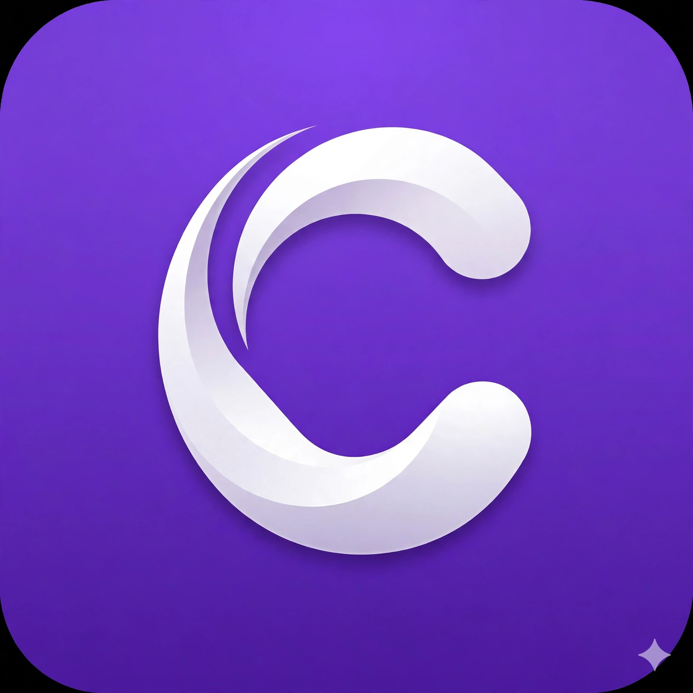
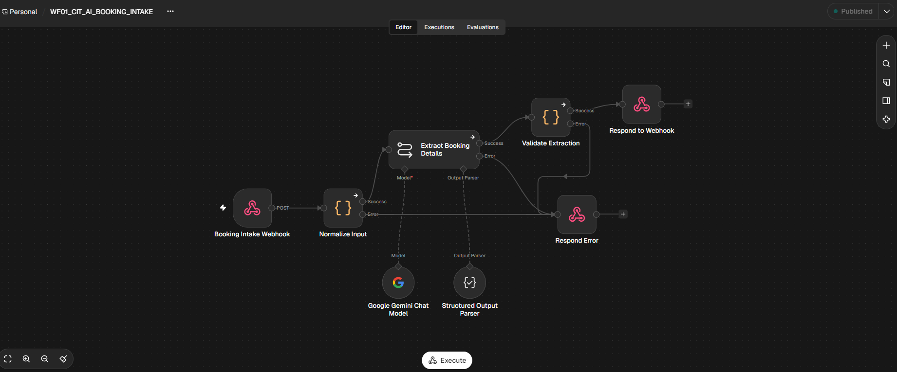
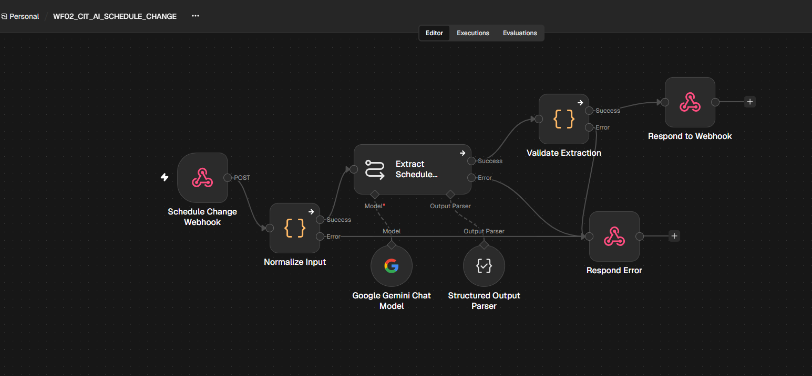
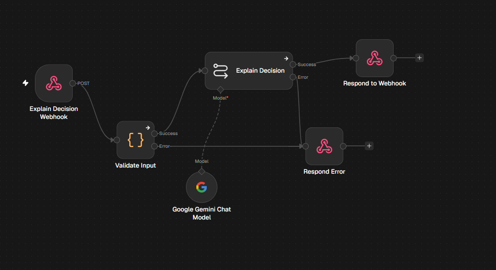

<div align="center">



# CAMPORA
### by MERUBYTE
**AI-Assisted Campus Scheduling & Venue Management Platform**  
Chilika Institute of Technology (CIT) · Crunch Week Hackathon

[](https://cit.saubhagyalabs.tech/)
[](https://cit.saubhagyalabs.tech/api/exports/verify)
[](https://cit.saubhagyalabs.tech/api/exports/spectra_allocations.json)
[](https://cit.saubhagyalabs.tech/api/exports/schedule_after.json)

**[Open Live Application](https://cit.saubhagyalabs.tech/)** ·
**[Validator Report](https://cit.saubhagyalabs.tech/api/exports/verify)** ·
**[AI Usage Declaration](AI_USAGE.md)** ·
**[Third-Party Disclosures](THIRD_PARTY.md)** ·
**[Final Documentation](docs/FINAL_DOCUMENTATION.md)**

</div>

---

## 1. Project at a glance

CAMPORA is a campus operations platform built for Chilika Institute of Technology. It brings academic timetable generation, midsem examination scheduling, venue booking decisions and disruption recovery into one role-based web application.

The system is designed around a strict principle:

> **AI may interpret a request and explain a result; deterministic application code decides whether a timetable or booking is valid.**

### The problem

During CIT's Week 7 “Crunch Week”, regular teaching, upcoming midsem examinations and Spectra fest venue requests compete for rooms, faculty time and student availability. Last-minute faculty absences and room closures can create further clashes.

CAMPORA addresses the challenge by combining:
- Constraint-based timetable and examination scheduling.
- Rule-based venue booking decisions with priority handling.
- Disruption recovery that aims to minimise changes.
- English and Hinglish request interpretation through an AI Copilot.
- Role-based dashboards, approvals and operational visibility.

### Dataset handled

| Dataset item | Official dataset size |
|---|---:|
| Rooms | 27 |
| Faculty members | 40 |
| Student groups / cohorts | 14 |
| Courses | 62 |
| Teaching sessions | 189 |
| Weekly teaching hours | 243 |
| Spectra venue requests | 25 (one later cancelled) |
| Midsem examinations | 41 |

CAMPORA uses the official `cit_public.json` dataset supplied in the hackathon starter pack. The dataset already defines each session's faculty and student groups; the scheduling engine assigns the day, start period and room.

---

## 2. Judge quick-start guide

**The live application is the primary evaluation surface.** Judges can use the demo accounts below or the one-click demo login buttons on the login page.

1. Open [cit.saubhagyalabs.tech](https://cit.saubhagyalabs.tech/).
2. Sign in using one of the demo accounts.
3. Start with the role-specific dashboard.
4. Use **Reset Demo Data** from the Admin account before a fresh evaluation run.
5. Use the workflows in the table below to inspect the core requirements.

### Suggested evaluation journeys

| What a judge wants to test | Where to go | What to verify |
|---|---|---|
| Read a timetable | Timetable / schedule views | Group, faculty and room views are understandable; sessions show useful details. |
| Find a room | Room / venue booking area | Search and availability information help identify a suitable venue. |
| Generate a timetable | Admin timetable area | The generated schedule is checked against the hard constraints. |
| Submit a natural-language request | AI Copilot / booking assistant | English or Hinglish text is converted into editable structured fields. |
| Check a booking decision | Spectra / booking management | Approval, rejection or alternative includes a meaningful reason and follows priority rules. |
| Test a disruption | Rescheduling / disruption area | Proposed changes are shown before they are committed; Admin approval is required. |
| Verify results | Validator / exports | The official validator report and generated JSON exports can be inspected. |

---

## 3. Demo accounts

The problem statement requires working demo accounts for all four roles. These accounts are provided for hackathon evaluation.

| Role | Demo email | Demo password | Suggested evaluation |
|---|---|---|---|
| Admin (Dean Academic) | `admin@cit.edu` | `CitAdmin2027!` | Generate schedules, inspect approvals, review disruption proposals and reset demo data. |
| Department Coordinator (CSE) | `coord.cse@cit.edu` | `CitCoord2027!` | Inspect department/cohort timetables, elective baskets and department-related room workflows. |
| Faculty (Dr. S. Rath) | `faculty.f19@cit.edu` | `CitFaculty2027!` | View faculty F19's timetable and workload, mark unavailability and inspect session/exam duties. |
| Club Representative (Dramatics) | `dramatics@cit.edu` | `CitClub2027!` | Submit Spectra venue requests, check request status/reasons and use the Copilot booking flow. |

**Demo reset:** The Admin dashboard provides a **Reset Demo Data** action intended to restore the demo environment to its initial dataset state. Use it before repeating evaluation scenarios.

> **Security note:** These are competition demo credentials. Do not reuse them for real institutional accounts. Rotate or disable them after the evaluation period. Keep production secrets and API keys out of this repository.

---

## 4. Judging criteria mapped to implementation

The following table maps the official judging categories to the relevant CAMPORA capability and the evidence judges can inspect.

| Official criterion | Marks | CAMPORA capability / evidence |
|---|---:|---|
| Scheduling correctness | 25 | Official validator checks timetable, bookings and exams. Current published validator result reports zero hard violations for the exported baseline. Judges may also generate a timetable in the app. |
| Rescheduling | 15 | Disruption workflow proposes a repaired schedule, reports moved sessions and presents changes for Admin review before application. Current published disruption export reports 11 sessions moved. |
| Optimisation | 10 | Solver optimises the six soft-constraint conditions; the official validator reports a soft score of 274 for the published baseline. Lower is better only if that is how the validator defines the penalty; compare using the official report. |
| Use of AI | 15 | Copilot interprets English/Hinglish requests, extracts booking details and supports explanations. The application validates every proposed action with deterministic code. |
| Booking decisions | 10 | Spectra allocation export reports 66.0 / 70.0 and zero priority inversions; booking decisions include reasons. |
| Usability and dashboard | 10 | Four role-based dashboards, timetable views, booking workflows, approvals and reset capability support independent judge testing. |
| UI and design | 10 | Live application is the evaluation surface. Timetable readability, consistent styling, responsive laptop/mobile layouts and loading/empty/error states should be checked in the deployed app. |
| Code and documentation | 5 | This README, architecture description, setup steps, demo accounts, `AI_USAGE.md`, `THIRD_PARTY.md` and `.env.example` support review and setup. |

**Important:** Scores and validator results above are the results recorded for the current published exports. Re-run the official validator after any schedule, booking, solver or export change. Do not treat a previous report as proof that a later generated schedule is valid.

---

## 5. Official validator results

The project README records a run against the official `validator.py` supplied in the hackathon starter pack.

### Baseline timetable

| Validator check | Recorded result |
|---|---|
| H1 — Session existence and completeness | PASS — 189 / 189 scheduled |
| H2 — Room capacity and suitability | PASS — 0 violations |
| H3 — Room double-booking | PASS — 0 violations |
| H4 — Faculty double-booking | PASS — 0 violations |
| H5 — Faculty availability | PASS — 0 violations |
| H6 — Faculty maximum daily hours | PASS — 0 violations |
| H7 — Student-group double-booking | PASS — 0 violations |
| H8 — Accessibility | PASS — 0 violations |
| H9 — Lab block constraints | PASS — 0 violations |
| H10 — Elective baskets and fixed slots | PASS — 0 violations |
| **Total hard violations** | **0** |

### Other recorded results

| Area | Recorded result |
|---|---:|
| Soft-constraint score | 274 |
| Spectra booking score | 66.0 / 70.0 |
| Spectra priority inversions | 0 |
| Midsem exams scheduled | 41 / 41 |
| Midsem exam hard violations | 0 |
| Sessions moved in disruption export | 11 |

**Disruption interpretation:** The published `schedule_after.json` is reported to have zero hard violations and 11 moved sessions (2 time changed, 9 room only) relative to the baseline. This README does not claim that 15 is a mathematically proven global minimum; the official comparison across teams determines the fewest-moves score.

Live evidence:
- [Open validator report](https://cit.saubhagyalabs.tech/api/exports/verify)
- [View Spectra allocations](https://cit.saubhagyalabs.tech/api/exports/spectra_allocations.json)
- [View post-disruption schedule](https://cit.saubhagyalabs.tech/api/exports/schedule_after.json)

---

## 6. Core capabilities

### 6.1 Academic timetable generation

- Generates a weekly timetable for the 189 teaching sessions in the official dataset.
- Supports views by student group, faculty and room.
- Uses a constraint solver to assign day, start period and room.
- Enforces the official hard constraints before a schedule is treated as valid.
- Provides a validator workflow for checking generated schedules.

### 6.2 Midsem examination scheduling

- Schedules all 41 midsem exams in the supplied dataset.
- Applies the exam-specific effective room capacity rule: room capacity is halved for exam capacity validation.
- Supports the examination schedule export.
- The published validator result records 41 / 41 exams scheduled with zero exam hard violations.

### 6.3 Venue booking and Spectra decisions

- Accepts venue requests in natural language and through structured booking flows.
- Converts request text into editable booking details before submission.
- Applies the official booking priority order:
  1. Exams
  2. Regular classes
  3. Institute events (including Spectra main events and convocation)
  4. Guest lectures
  5. Department events
  6. Club events
- Supports booking decisions and explanations.
- Published Spectra result: 66.0 / 70.0 with zero priority inversions.

### 6.4 Disruption recovery and rescheduling

The disruption workflow is designed for changes such as faculty leave, room closure and new sessions.

- Accepts the supplied sample disruption file and supports custom disruption JSON upload through the disruption interface.
- Uses the optimisation engine to propose a repaired schedule while aiming to minimise moved sessions.
- Reports the proposed changes for review.
- Requires Admin approval before proposed changes are committed.
- If a valid repair cannot be found, the application should communicate the conflict rather than apply an invalid schedule.

The current published disruption export reports 15 moved sessions (3 time changes and 12 room-only reassignments).

### 6.5 AI Copilot

The Copilot supports English and Hinglish request interpretation.

Examples:
- “Need auditorium for 350 students on Friday evening with sound system for cultural night.”
- “Kal shaam 5 baje 40 bacchon ke liye robotics club meeting ke liye room chahiye projector ke saath.”

The Copilot:
- Extracts structured booking parameters such as event title, attendance, requested time window and equipment needs.
- Helps users clarify or review request details.
- Can explain a decision using information returned by the application.
- Does **not** determine whether a booking or schedule is valid.

**AI safety boundary:** The LLM is not the authority for schedule validity, booking approval, priority, room availability or conflict resolution. Every AI-generated proposal must pass deterministic backend validation before it can affect application data. The manual booking workflow must remain available if the LLM service is unavailable.

### 6.6 Interactive schedule validation

- Drag-and-drop schedule moves trigger a pre-flight validation request before a move is committed.
- The interface can display the validation outcome and constraint impacts.
- The published feature matrix identifies `/api/schedules/validate-move` as the validation endpoint.
- The Admin interface includes a **Verify Zero Clashes** action that runs the validator against live data.

---

## 7. Hard constraints and operating rules

CAMPORA's scheduling and booking logic is designed around the official problem statement.

| Rule area | Required behaviour |
|---|---|
| Session completeness | Every session is scheduled exactly once. |
| Faculty conflicts | A faculty member cannot be assigned to overlapping sessions. |
| Student-group conflicts | A group cannot have overlapping sessions; combined lectures count for all included groups. |
| Elective baskets | Sessions in the same elective basket slot run at the same day and period and are handled as the stated exception. |
| Room conflicts | A room cannot host overlapping sessions or approved bookings. |
| Capacity | Room capacity must meet session size; exam capacity checks use half the room's stated capacity. |
| Room suitability | The room type must match the session requirement. |
| Availability | Faculty unavailability and room maintenance windows must be respected. |
| Lunch and labs | No session crosses 13:00–14:00 lunch; three-hour labs must fit P2–P4 or P6–P8. |
| Accessibility | Sessions requiring an accessible room must be assigned one. |
| Faculty daily limit | A faculty member must not exceed the dataset daily teaching limit (4 hours in the CIT data). |
| Fixed sessions | A session with a fixed slot must remain in that slot. |
| Booking conflicts | An approved booking must not overlap a session, another booking in the same room or a group for whom the event is mandatory. |

**Time model:** The teaching week is Monday to Friday, P1–P9. P1 starts at 08:00 and P9 at 17:00. Lunch is 13:00–14:00. P10–P13 (18:00–22:00) are reserved for events, not regular teaching sessions.

### Soft constraints considered

The solver's soft-constraint objective covers the six conditions listed in the problem statement:

1. Faculty scheduled during a time they asked to avoid.
2. A student group has a free period between two classes on the same day (lunch excluded).
3. A student group has more than six hours of class in one day.
4. A group has two lectures of the same course on the same day.
5. A session uses less than 40% of the room's capacity.
6. A session is scheduled in P9 (17:00).

The official validator is the source of truth for the reported soft penalty and its calculation.

---

## 8. Roles and permissions

The application implements the four roles defined by the problem statement.

| Role | Main responsibilities |
|---|---|
| Admin (Dean's Office) | Full system access; generates timetables; approves timetable changes and bookings that move a class; can change the priority order. |
| Department Coordinator | Requests changes to department sessions; books rooms for department events; approves bookings of their department's labs. |
| Faculty | Views their own timetable; marks unavailability; requests extra or moved sessions. |
| Club Representative | Submits and cancels venue requests; views the status and reason for each request. |

**Approval rule:** Nobody can approve their own request. Role permissions and approval checks must be enforced by the backend, not only by hiding frontend controls.

---

## 9. System architecture

```text
                         Evaluator / User Browser
                                  |
                         HTTPS: cit.saubhagyalabs.tech
                                  |
                            Caddy Server
                         (TLS / Reverse Proxy)
                                  |
              +-------------------+-------------------+
              |                   |                   |
              v                   v                   v
        React 18 + Vite      Node.js / Express    WhatsApp Gateway
        Frontend             + Prisma API         (Evolution-Go)
                                  |
                    +-------------+-------------+
                    |                           |
                    v                           v
              MySQL 8.0                  Python FastAPI
              cit_campus_os              Optimisation Service
                                               |
                                               v
                                        Google OR-Tools
                                          CP-SAT Solver

        WhatsApp gateway authentication data: PostgreSQL 15
```

### Main components

| Component | Technology | Responsibility |
|---|---|---|
| Frontend (`client/`) | React 18, Vite, TypeScript, Tailwind CSS, Lucide, Radix UI | Role-based dashboards, timetable grid, booking flows, Copilot interface and user interactions. |
| Backend (`server/`) | Node.js 20, Express, Prisma | API gateway, JWT sessions, role-based authorisation, audit logging and dataset reset/seeding. |
| Optimisation service (`optimizer/`) | Python 3.11, FastAPI, Google OR-Tools CP-SAT | Constraint-based timetable and disruption optimisation. |
| Primary application database | MySQL 8.0 | Campus application data (`cit_campus_os`). |
| Notification gateway | Evolution-Go | WhatsApp notification integration. |
| Gateway authentication database | PostgreSQL 15 | Evolution-Go user/authentication data. |

The architecture separates the user interface, application API, optimisation logic and notification gateway so that schedule validation is not delegated to the LLM.

---

## 10. Export files and verification

The application exposes the following generated JSON exports:

| File | Contents | Link |
|---|---|---|
| `schedule.json` | Baseline academic timetable, exams and booking data in the application's export format. | [Download](https://cit.saubhagyalabs.tech/api/exports/schedule.json) |
| `schedule_after.json` | Schedule after applying the sample disruption. | [Download](https://cit.saubhagyalabs.tech/api/exports/schedule_after.json) |
| `exam_schedule.json` | Midsem examination schedule / seating allocation. | [Download](https://cit.saubhagyalabs.tech/api/exports/exam_schedule.json) |
| `spectra_allocations.json` | Spectra booking decisions and allocations. | [Download](https://cit.saubhagyalabs.tech/api/exports/spectra_allocations.json) |

The required submission exports are `exports/schedule.json` and `exports/schedule_after.json`. The additional exports above are provided for inspection where available.

### Run the official validator locally

Run these commands from the repository root. Adjust the starter-pack directory path only if the repository stores the starter pack in a different location.

```bash
# Validate the baseline schedule
python "docs/PS/CrunchWeek_StarterPack (1)/CrunchWeek_StarterPack/validator.py" \
  --data "docs/PS/CrunchWeek_StarterPack (1)/CrunchWeek_StarterPack/data/cit_public.json" \
  --schedule exports/schedule.json

# Validate the schedule after the supplied disruption
python "docs/PS/CrunchWeek_StarterPack (1)/CrunchWeek_StarterPack/validator.py" \
  --data "docs/PS/CrunchWeek_StarterPack (1)/CrunchWeek_StarterPack/data/cit_public.json" \
  --schedule exports/schedule_after.json \
  --disruption "docs/PS/CrunchWeek_StarterPack (1)/CrunchWeek_StarterPack/examples/sample_disruption.json" \
  --baseline exports/schedule.json
```

**Before submission:** run the unmodified official validator against the final committed exports and retain the output for the team’s records.

---

## 11. Local development setup

### Prerequisites

- Node.js 18 or later and npm.
- Python 3.10 or later and pip.
- MySQL 8.0 running locally on port `3306`.
- Any additional services and environment variables documented in `.env.example`.

### 1. Clone the repository

```bash
git clone https://github.com/Akshat-sin-official/TZ-Meru-Byte.git
cd TZ-Meru-Byte
```

### 2. Configure environment variables

```bash
cp .env.example server/.env
```

Open `server/.env` and set the required local values. Do not commit `.env` or real API keys.

### 3. Install and start the backend

```bash
cd server
npm install
npx prisma db push
node dist/seed.js
npm run dev
```

The backend is expected to run at `http://localhost:5000`.

### 4. Install and start the optimisation service

In a separate terminal:

```bash
cd optimizer
pip install -r requirements.txt
uvicorn main:app --port 8001
```

The optimiser is expected to run at `http://localhost:8001`.

### 5. Install and start the frontend

In a separate terminal:

```bash
cd client
npm install
npm run dev
```

The Vite development server is expected to run at `http://localhost:5173`.

**Setup verification:** The commands above reflect the current project setup documented by the team. If a clean clone fails, update these instructions and `.env.example` before submission so a judge can reproduce the setup.

---


## 11. n8n Cloud AI workflows

CAMPORA integrates Google Gemini AI with n8n Cloud for natural-language booking intake, schedule-change request processing and booking-decision explanations.

**n8n Cloud workspace:** [techzephyr.app.n8n.cloud](https://techzephyr.app.n8n.cloud)

> **Important:** n8n and Gemini assist with understanding and communication. They do not approve bookings, change schedules or determine whether a proposed allocation is valid. The Express backend and deterministic scheduling/validation services remain authoritative.

### Workflow overview

| Workflow | Webhook endpoint | Purpose | Result |
|---|---|---|---|
| **WF01 — AI Booking Intake** | `POST /webhook/cit/ai/booking-intake` | Understands English, Hindi and Hinglish venue requests; extracts booking details; identifies missing or ambiguous fields; uses prior booking drafts for multi-turn context. | Structured booking draft, status, missing fields and assistant message. |
| **WF02 — AI Schedule Change** | `POST /webhook/cit/ai/schedule-change` | Interprets faculty unavailability and room-closure requests; extracts affected resources, date, change type and reason; identifies when backend optimisation is needed. | Structured schedule-change request, status and clarification message. |
| **WF03 — AI Decision Explainer** | `POST /webhook/cit/ai/explain-decision` | Explains an authoritative booking decision returned by the backend in simple English, Hindi or Hinglish. | Assistant explanation, decision status and supplied reason codes. |

### WF01 — AI Booking Intake



**Flow:** Booking Intake Webhook → Normalize Input → Extract Booking Details (Gemini Chat Model + Structured Output Parser) → Validate Extraction → Respond to Webhook. Invalid or incomplete extraction follows the error response path.

- Accepts natural-language booking requests in English, Hindi and Hinglish.
- Extracts venue, date, time, event type, purpose and expected attendance.
- Identifies missing or ambiguous information for clarification.
- Accepts previous booking drafts supplied by the backend to support multi-turn conversations.
- Returns an editable draft; it does not create or approve a booking.

### WF02 — AI Schedule Change



**Flow:** Schedule Change Webhook → Normalize Input → Extract Schedule Change (Gemini Chat Model + Structured Output Parser) → Validate Extraction → Respond to Webhook. Invalid input follows the error response path.

- Understands faculty-unavailability and room-closure requests.
- Extracts affected faculty or room, date, change type and reason.
- Identifies whether backend optimisation is required.
- Sends structured disruption information to the Express backend.
- The backend maps the request to application records and communicates with the Python CP-SAT optimiser. The workflow itself does not directly modify the timetable.

### WF03 — AI Decision Explainer



**Flow:** Explain Decision Webhook → Validate Input → Explain Decision (Gemini Chat Model) → Respond to Webhook. Invalid input follows the error response path.

- Receives the authoritative decision and reason codes from the backend.
- Explains approval or rejection outcomes in simple language.
- Supports English, Hindi and Hinglish.
- Does not approve, reject, or modify the underlying decision.

### Backend integration and API routes

The Node.js Express backend calls n8n through Axios using:

`server/src/utils/n8nClient.ts`

| Backend route | Responsibility |
|---|---|
| `POST /api/ai/booking-intake` | Forwards booking-intake text and conversation context to WF01. |
| `POST /api/ai/schedule-change` | Forwards a schedule-change request to WF02. |
| `POST /api/ai/decision-explainer` | Sends a backend decision and reason details to WF03 for explanation. |
| `GET /api/ai/conversations/:id` | Retrieves a conversation and its stored messages. |

**Webhook authentication:** Backend-to-n8n requests use the `x-cit-webhook-secret` header. The secret is stored in environment variables and must never be exposed to the frontend or committed to Git.

### Conversation memory

- MySQL stores AI conversations and messages.
- Conversations are scoped to authenticated user IDs.
- Booking drafts accumulate across multiple messages.
- The backend supplies previous drafts to WF01 so the workflow can interpret follow-up messages in context.

### AI execution modes

CIT Copilot supports three documented execution modes:

1. **n8n Only** — sends requests through the n8n workflows.
2. **Gemini Only** — uses the direct Gemini integration.
3. **Compare Both** — runs both paths so their responses can be compared.

### Error handling and safe fallback

- Invalid workflow input returns a validation/error response.
- n8n or Gemini failures are returned as sanitised errors.
- The backend supports deterministic/manual fallback when AI services fail.
- Manual booking must remain usable even when n8n or Gemini is unavailable.
- A workflow response is a suggestion or explanation, never an authorisation to commit a booking or timetable change.

### Workflow configuration and operational checklist

1. Configure the n8n Cloud workspace and the three workflows using the webhook paths listed above.
2. Configure the Google Gemini Chat Model credentials inside n8n; keep credentials in n8n's credential store rather than in workflow screenshots or source control.
3. Configure the backend's n8n base URL and webhook secret in the server environment. Use `.env.example` for the variable names and placeholder values.
4. Ensure `server/src/utils/n8nClient.ts` sends the expected webhook paths and `x-cit-webhook-secret` header.
5. Test each webhook with valid, incomplete and invalid input; confirm both success and error responses.
6. Test booking-intake follow-ups to confirm that backend-supplied prior drafts are used.
7. Simulate n8n/Gemini unavailability and verify that manual booking and deterministic backend validation still work.
8. Confirm that schedule-change proposals pass through backend optimisation, validation and the required approval flow before any timetable change is committed.

**Workflow asset note:** The repository includes the three supplied n8n workflow screenshots and `docs/N8N/n8n.md`. The uploaded project archive did not contain n8n workflow export JSON files. To make the workflows independently importable into another n8n workspace, export each workflow from n8n as JSON and add those exports to `docs/N8N/`.

### n8n documentation

See [`docs/N8N/n8n.md`](docs/N8N/n8n.md) for the workflow integration notes and endpoint summary.

---

## 12. AI use, third-party software and environment configuration

The repository should include these supporting files:

| File | What it documents |
|---|---|
| `AI_USAGE.md` | Every AI model/API called by the product, its purpose, every AI tool used during development and what it helped with, prompt locations, and decisions the LLM is not allowed to make. |
| `THIRD_PARTY.md` | Open-source libraries, frameworks, solvers and third-party services used by the project. |
| `.env.example` | Every required environment variable, with placeholder values only and no real secrets. |

### AI safety boundary

- The LLM may interpret requests, ask follow-up questions, populate structured fields and explain application decisions.
- Deterministic application code must validate schedule and booking feasibility.
- Every AI-generated proposal must pass backend validation before it changes data.
- The LLM must not approve bookings, override priority rules or independently decide that a timetable is valid.
- Manual booking must remain available when the LLM API is unavailable.

**Undeclared AI usage carries a 10-mark deduction under the official rules.** Ensure `AI_USAGE.md` is accurate and complete before submission.

---

## 13. Known limitations and evaluation notes

- Natural-language extraction can be ambiguous. Users should review and edit the structured request before submitting it.
- AI-assisted request interpretation depends on the configured AI service; the manual booking path must be used if that service is unavailable.
- The validator figures in this README describe the recorded published run. Results must be regenerated after changes to the dataset, solver, booking logic or exported schedules.
- The setup instructions depend on the environment variables and services configured for the project. Consult `.env.example` and the supporting documentation.
- Add any further known limitations discovered during final testing here. Do not claim a feature is fully reliable unless it has been tested on the deployed application.

---

## 14. Submission compliance checklist

- [ ] Public GitHub repository is accessible.
- [ ] Repository was created after the hackathon started.
- [ ] `README.md` includes project overview, architecture, stack, setup, demo accounts and known limitations.
- [ ] `.env.example` lists all required variables and contains no real secrets.
- [ ] `AI_USAGE.md` is complete and accurate.
- [ ] `THIRD_PARTY.md` lists the libraries, solvers and services used.
- [ ] `exports/schedule.json` is generated by the application.
- [ ] `exports/schedule_after.json` is generated by applying `sample_disruption.json`.
- [ ] Final exports pass the unmodified official validator.
- [ ] Live deployment remains available until results are announced.
- [ ] All four demo accounts work on the deployed application.
- [ ] Admin demo reset works.
- [ ] Five-minute maximum walkthrough video is submitted with judge access.
- [ ] Video demonstrates timetable generation, natural-language booking, blocked conflict, Spectra decisions, disruption rescheduling with approval and dashboard use.
- [ ] No code, deployment or exported results are changed after the submission deadline.

**Disqualification warning:** The official rules include disqualification for an inaccessible/private repository, missing or non-working deployment, missing or non-working demo accounts, missing video, prohibited pre-existing/bought/copied code, post-deadline changes, fabricated or manually edited results, unauthorised outside contributors, or tampering with organiser files/validator or another team's work.

---

<div align="center">

**CAMPORA — The Intelligence Behind Every Campus.**  
Built by **MERUBYTE** for the Chilika Institute of Technology Crunch Week Hackathon.

</div>
