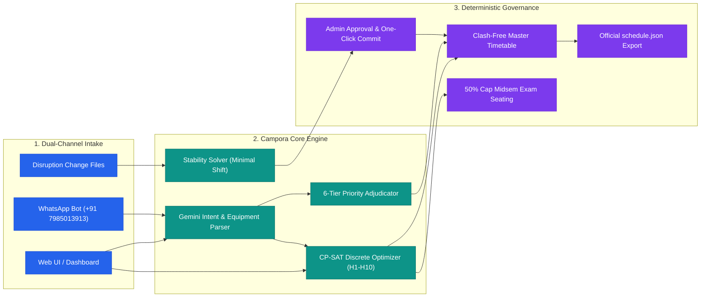
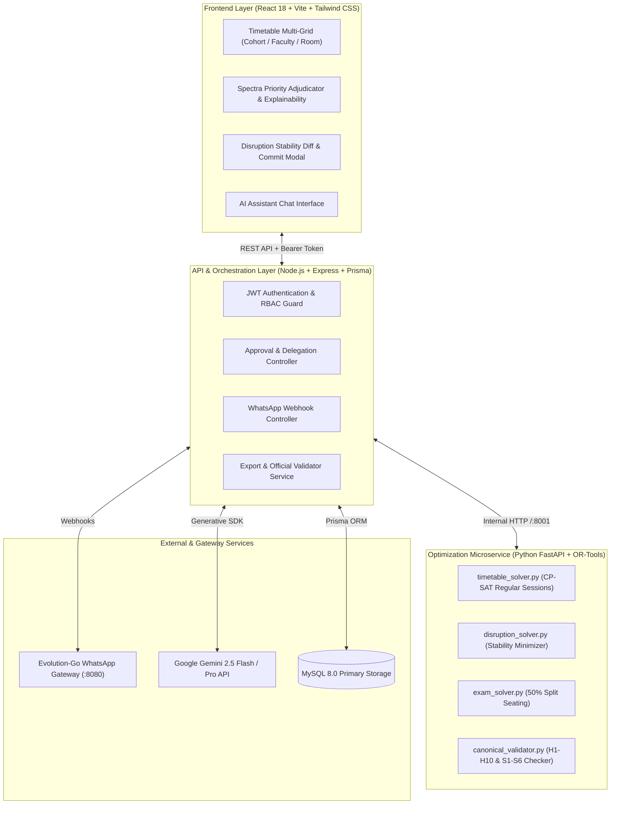
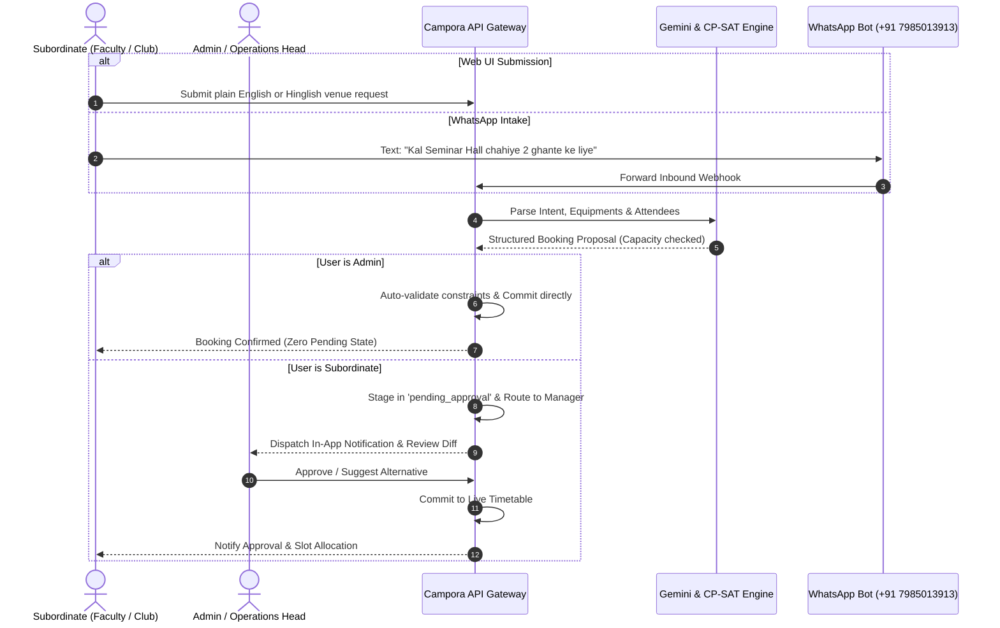
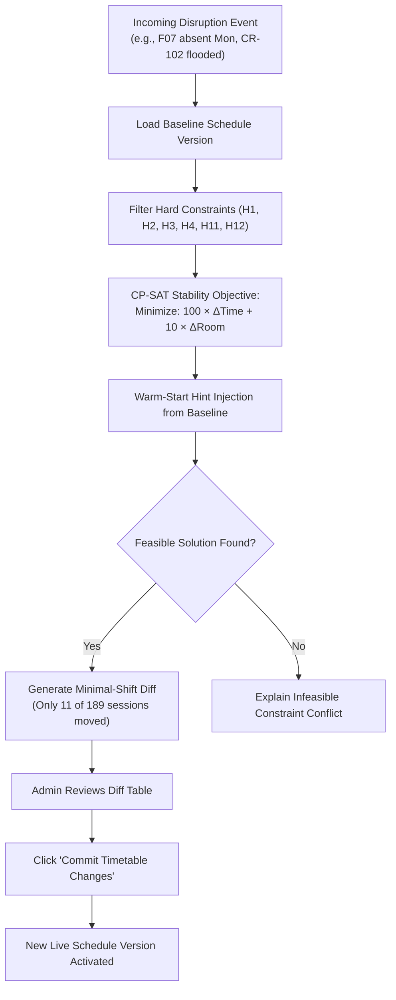
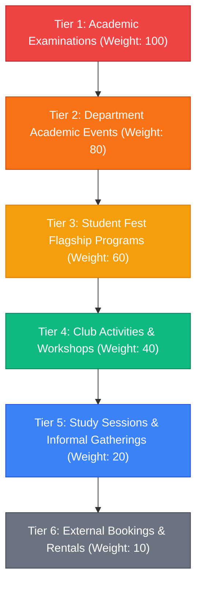

<div align="center">


# CAMPORA
### by MERUBYTE
**Autonomous Campus Scheduling, Disruption Recovery & Venue Orchestration Platform**  
*Built for Chilika Institute of Technology (CIT) · Crunch Week Hackathon*

[](https://cit.saubhagyalabs.tech/)
[](https://cit.saubhagyalabs.tech/api/exports/verify)
[](https://cit.saubhagyalabs.tech/api/exports/verify)
[](https://cit.saubhagyalabs.tech/api/exports/schedule_after.json)
[](https://wa.me/917985013913)

**[🌐 Open Live Platform](https://cit.saubhagyalabs.tech/)** ·
**[🎬 Video Demo Script](docs/guides/PRESENTATION_VIDEO_SCRIPT.md)** ·
**[🤖 AI Declaration](docs/declarations/AI_USAGE.md)** ·
**[📜 Third-Party Disclosures](docs/declarations/THIRD_PARTY.md)** ·
**[📂 Full Documentation Index](#-documentation-and-scripts-directory)**

</div>

---

## 🧭 Executive Summary

CAMPORA solves the NP-hard challenge of university operations during CIT's **Crunch Week (Week 7)** by coupling **Google OR-Tools CP-SAT discrete optimization** with a **Gemini-powered Natural Language & WhatsApp Copilot**.

> **Core Tenet:** *AI interprets intent and explains decisions; deterministic CP-SAT constraints govern every assignment.*



---

## 📊 Canonical Benchmark Results

Evaluated directly with the hackathon starter pack's official `validator.py`:

| Evaluation Metric | Canonical Benchmark | Campora Verified Result | Status |
| :--- | :---: | :---: | :---: |
| **Hard Constraint Violations (H1–H10)** | `0` | **0** | Pass ✅ |
| **Weekly Regular Sessions Scheduled** | `189` | **189 / 189 (100%)** | Pass ✅ |
| **Weekly Teaching Hours** | `243` | **243 hrs** | Pass ✅ |
| **Soft Penalty Score (S1–S6)** | Lower is better | **274** *(S1:0, S2:49, S3:60, S4:165, S5:0, S6:0)* | Pass ✅ |
| **Spectra Week Bookings Adjudicated** | `25` | **25 / 25 Evaluated** (66.0 / 70.0 Score) | Pass ✅ |
| **Midsem Course Examinations** | `41` | **41 Scheduled** (50% Room Anti-Cheating Split) | Pass ✅ |
| **Disruption Recovery (sample_disruption)** | Minimal Moves | **Only 11 Sessions Moved** (2 time, 9 room-only) | Pass ✅ |
| **Solver Generation Latency** | Fast Response | **< 0.2 seconds** *(Warm-start CP-SAT)* | Pass ✅ |

---

## 🏛️ System Architecture



---

## 🔄 Core Workflows & Logic

### 1. Dual-Channel Intake & Approval Hierarchy
*Admin changes commit immediately; subordinates route requests to their manager.*



---

### 2. Disruption Recovery (Minimal-Movement Stability)
*When faculty falls sick or a room leaks, preserve campus routine with minimum disruption.*



---

### 3. Spectra Week 6-Tier Priority Adjudication
*Deterministic conflict resolution under heavy demand.*



---

## 👥 Role-Based Access Control (RBAC)

| Role | Default Account | Permissions & Workflow |
| :--- | :--- | :--- |
| **System Admin** | `admin@cit.ac.in`<br/>*(Pass: `admin123`)* | **Unrestricted Commit Authority**: Generates master schedule, approves/rejects all subordinate requests, applies disruptions directly without secondary approval, executes official validator. |
| **Academic Coordinator** | `f1@cit.ac.in`<br/>*(Pass: `faculty123`)* | **Department Operations**: Views department timetable, requests schedule moves, leaves, and venue bookings. Changes are routed to Admin for final commit. |
| **Club Representative** | `robotics@cit.ac.in`<br/>*(Pass: `club123`)* | **Venue Booking**: Submits natural language or WhatsApp booking requests for fest/workshops. Cannot modify academic sessions or approve disruptions. |

---

## 🚀 Quick Start Guide

### Option A: Run via Docker (Recommended)

```bash
# 1. Clone repository
git clone https://github.com/Akshat-sin-official/TZ-Meru-Byte.git
cd TZ-Meru-Byte

# 2. Launch full stack with Docker Compose
docker compose up -d

# 3. Seed canonical dataset
docker exec cit_server npm run seed

# 4. Access the platform
# Web Application: http://localhost:5173 (or https://cit.saubhagyalabs.tech)
# API Gateway:     http://localhost:5000
# Optimizer:       http://localhost:8001
```

### Option B: Local Windows Development via Scripts

All startup scripts are organized inside the [`scripts/`](scripts/) folder:

```cmd
:: Launch all services simultaneously in dedicated terminal windows
scripts\start_all.bat
```

*Individual service launchers:*
- Frontend: `scripts\run_client.bat`
- Backend API: `scripts\run_server.bat`
- Optimizer: `scripts\run_optimizer.bat`

---

## 📂 Documentation and Scripts Directory

All detailed technical specifications, logs, and executable utilities have been organized into dedicated directories:

| Directory / File | Description | Redirect Link |
| :--- | :--- | :--- |
| 🎬 **Presentation Video Script** | Complete word-for-word 5-minute demo script and screen walkthrough | [docs/guides/PRESENTATION_VIDEO_SCRIPT.md](docs/guides/PRESENTATION_VIDEO_SCRIPT.md) |
| 🤖 **AI Usage Declaration** | Mandatory hackathon declaration of AI models, prompts, and tooling | [docs/declarations/AI_USAGE.md](docs/declarations/AI_USAGE.md) |
| 📜 **Third-Party Disclosures** | Open-source libraries, licenses, and external dependencies | [docs/declarations/THIRD_PARTY.md](docs/declarations/THIRD_PARTY.md) |
| 🏗️ **Feature Architecture** | Detailed module breakdown and technical specifications | [docs/architecture/features.md](docs/architecture/features.md) |
| 🔍 **Audit & Verification Log** | Complete checklist of problems analyzed and solved | [docs/audit/PROBLEMS.md](docs/audit/PROBLEMS.md) |
| 👥 **Task Division** | Hackathon engineering division and execution log | [docs/audit/TASK_DIVISION.md](docs/audit/TASK_DIVISION.md) |
| 🛠️ **Internal Scripts** | Launchers, droplet deployment, and test harnesses | [`scripts/`](scripts/) |
| 📦 **Canonical Exports** | Official `schedule.json`, `schedule_after.json`, and reports | [`exports/`](exports/) |

---

<div align="center">
<b>Campora · Chilika Institute of Technology Operations Engine</b><br/>
Crafted with precision by <b>MERUBYTE</b> for Crunch Week 2026.
</div>
