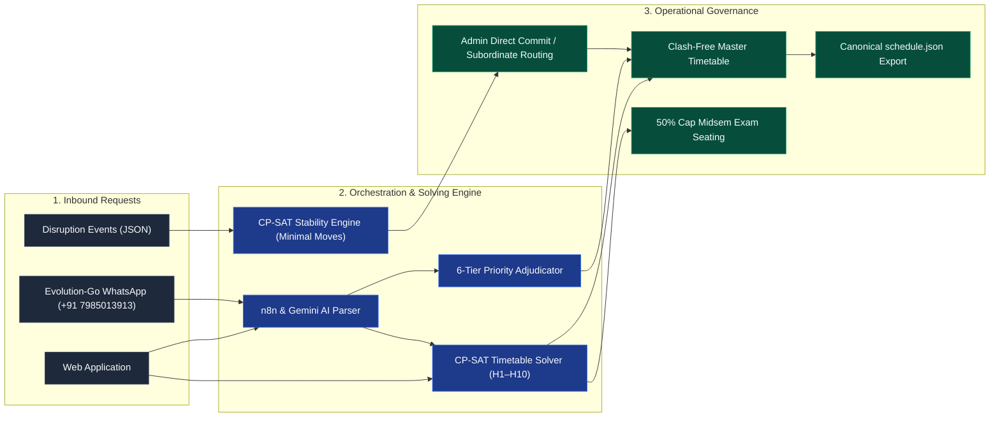
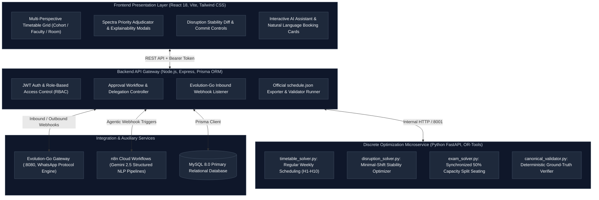
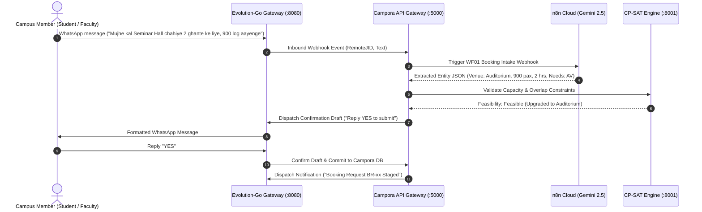
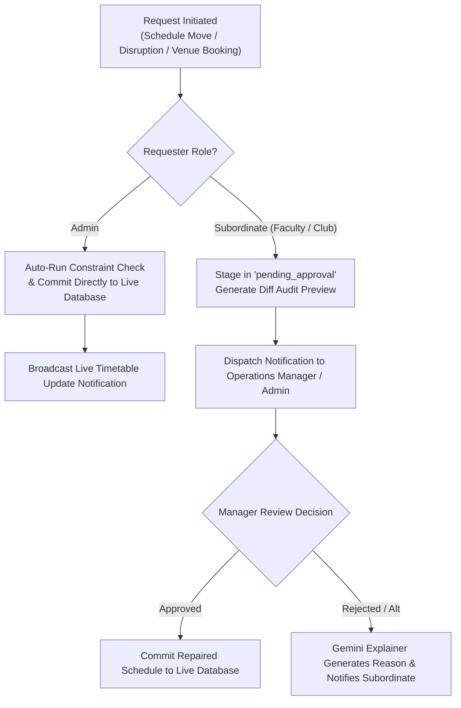
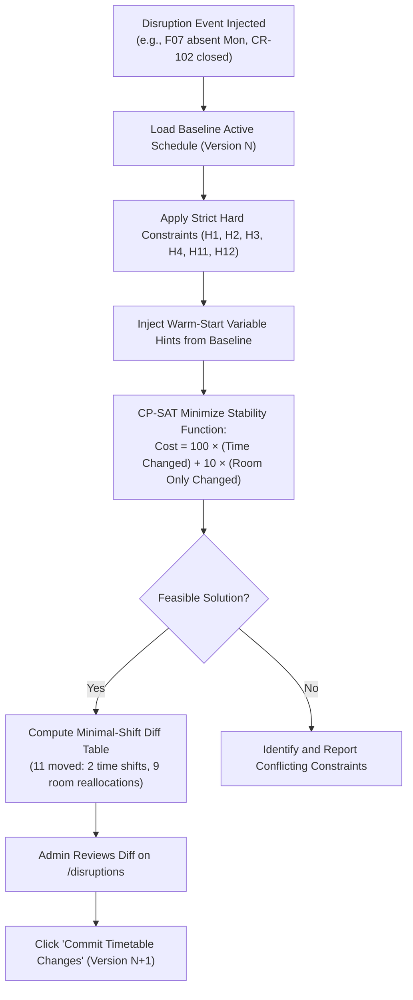
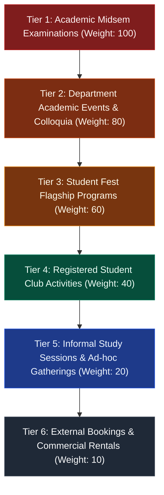

<div align="center">


# CAMPORA
### by MERUBYTE
**Autonomous Campus Scheduling, Disruption Recovery & Venue Orchestration Platform**  
*Chilika Institute of Technology (CIT) · Tech Zephyr 4 Hackathon*

[](https://cit.saubhagyalabs.tech/)
[](https://cit.saubhagyalabs.tech/api/exports/verify)
[](https://cit.saubhagyalabs.tech/api/exports/verify)
[](https://cit.saubhagyalabs.tech/api/exports/schedule_after.json)
[](https://wa.me/917985013913)
[](https://techzephyr.app.n8n.cloud)
[](docs/architecture/features.md)

[Live Platform](https://cit.saubhagyalabs.tech/) · [Demo Walkthrough Script](docs/guides/PRESENTATION_VIDEO_SCRIPT.md) · [AI Declaration](docs/declarations/AI_USAGE.md) · [Third-Party Disclosures](docs/declarations/THIRD_PARTY.md) · [Documentation Index](#documentation-and-scripts-directory)

</div>

---

## Executive Overview

CAMPORA resolves complex university scheduling and resource allocation challenges for Chilika Institute of Technology during Week 7 (Crunch Week). It pairs **Google OR-Tools CP-SAT discrete optimization** with a **Gemini-powered Natural Language Copilot** integrated across web and **Evolution-Go WhatsApp** channels.

> **Design Axiom:** *AI models interpret intent and explain decisions; deterministic constraint solvers govern every schedule and booking commit.*



---

## Canonical Benchmark Verification

Results validated directly against the official `validator.py` on the canonical `cit-public-v1` dataset:

| Criterion | Target Metric | Campora Evaluated Result | Outcome |
| :--- | :---: | :---: | :---: |
| **Hard Constraint Violations (H1–H10)** | `0` | **0** | Verified |
| **Weekly Regular Teaching Sessions** | `189` | **189 / 189 (100%)** | Verified |
| **Weekly Scheduled Teaching Hours** | `243` | **243 Hours** | Verified |
| **Soft Penalty Score (S1–S6)** | Minimized | **274** *(S1:0, S2:49, S3:60, S4:165, S5:0, S6:0)* | Verified |
| **Spectra Week Bookings Adjudicated** | `25` | **25 / 25 Evaluated** (Score: 66.0 / 70.0) | Verified |
| **Midsem Course Examinations** | `41` | **41 Scheduled** (50% Room Anti-Cheating Split) | Verified |
| **Disruption Recovery (Sample Disruption)** | Minimal Moves | **11 Sessions Moved** (2 time, 9 room-only) | Verified |
| **Disruption Solve Latency** | Instant Response | **0.07 Seconds** *(Warm-Start CP-SAT)* | Verified |
| **Timetable Generation Latency** | Instant Response | **0.11 Seconds** *(Warm-Start CP-SAT)* | Verified |

---

## System Architecture



---

## WhatsApp & n8n AI Workflows

CAMPORA pairs the high-performance **Evolution-Go Gateway** with **n8n Cloud Workflows** to handle unstructured natural language requests in English and Hinglish.



### WF01 — AI Booking Intake Pipeline
Accepts free-form English, Hindi, and Hinglish venue requests, extracts required attendees, timings, and technical equipment, and auto-upgrades venue tiers when capacity thresholds are exceeded.


### WF02 — AI Schedule Change & Disruption Processing
Parses faculty leave notices and room maintenance windows, structuring disruption payloads for the CP-SAT stability solver while preserving untouched sessions.


### WF03 — Decision Explainer & Transparent Reasoning
Generates human-readable, auditable mathematical justifications for approved, alternative, or rejected requests based on constraint telemetry and priority ranking.


---

## Operational Workflows

### 1. Approval Governance & Separation of Duties
*Admins commit changes directly; academic coordinators and student clubs submit drafts that route to their managers for review.*



---

### 2. Disruption Recovery (Minimal-Movement Stability)
*Preserves campus stability by penalizing session rescheduling.*



---

### 3. Spectra Week 6-Tier Priority Adjudication
*Deterministic hierarchy enforced during festival congestion.*



---

## Role-Based Access Control (RBAC) Matrix

| Platform Role | Demo Credentials | Operational Scope |
| :--- | :--- | :--- |
| **System Admin** | `admin@cit.ac.in`<br/>Password: `admin123` | **Direct Commit Authority:** Master schedule generation, disruption repair execution, override approvals, official validator execution. Changes commit without intermediary approval. |
| **Academic Coordinator** | `f1@cit.ac.in`<br/>Password: `faculty123` | **Department Scope:** Timetable and room inspection, leave requests, session movement submissions. Requests route to Admin. |
| **Club Representative** | `robotics@cit.ac.in`<br/>Password: `club123` | **Event Booking Scope:** Venue booking submissions via Web UI or Evolution-Go WhatsApp. Strictly isolated from academic modification permissions. |

---

## Setup & Deployment Guide

### Option 1: Docker Compose (Production & Staging)

```bash
# 1. Clone repository
git clone https://github.com/Akshat-sin-official/TZ-Meru-Byte.git
cd TZ-Meru-Byte

# 2. Launch container stack
docker compose up -d

# 3. Seed canonical dataset
docker exec cit_server npm run seed

# 4. Access live endpoints
# UI:          http://localhost:5173
# API Gateway: http://localhost:5000
# Optimizer:   http://localhost:8001
```

### Option 2: Local Windows Development via Internal Scripts

All launcher scripts are centrally located in [`scripts/`](scripts/):

```cmd
:: Launch all platform microservices simultaneously
scripts\start_all.bat
```

*Individual service scripts:*
- UI Server: `scripts\run_client.bat`
- Node.js API: `scripts\run_server.bat`
- Python Optimizer: `scripts\run_optimizer.bat`

---

## Documentation and Scripts Directory

Technical specifications, declarations, and testing scripts are organized into dedicated directories:

| Resource | Description | Redirect Link |
| :--- | :--- | :--- |
| **Presentation Video Script** | Word-for-word 5-minute recording script and demonstration walkthrough | [docs/guides/PRESENTATION_VIDEO_SCRIPT.md](docs/guides/PRESENTATION_VIDEO_SCRIPT.md) |
| **AI Usage Declaration** | Mandatory hackathon AI disclosures and model declarations | [docs/declarations/AI_USAGE.md](docs/declarations/AI_USAGE.md) |
| **Third-Party Disclosures** | Open-source libraries, frameworks, and licensing declarations | [docs/declarations/THIRD_PARTY.md](docs/declarations/THIRD_PARTY.md) |
| **System Feature Architecture** | In-depth engineering specifications for every Campora engine module | [docs/architecture/features.md](docs/architecture/features.md) |
| **Audit & Verification Log** | Problems analyzed, corrected, and verified across testing phases | [docs/audit/PROBLEMS.md](docs/audit/PROBLEMS.md) |
| **Hackathon Task Division** | Team engineering split and delivery verification log | [docs/audit/TASK_DIVISION.md](docs/audit/TASK_DIVISION.md) |
| **n8n Workflow Specifications** | Webhook contracts, payload structures, and workflow architecture | [docs/N8N/n8n.md](docs/N8N/n8n.md) |
| **Internal Scripts** | Launchers, droplet deployment tools, and latency benchmarks | [`scripts/`](scripts/) |
| **Canonical Exports** | Verified `schedule.json`, `schedule_after.json`, and validator reports | [`exports/`](exports/) |

---

<div align="center">
<b>Campora · Chilika Institute of Technology Operations Engine</b><br/>
Engineered by <b>MERUBYTE</b> for Tech Zephyr 4.
</div>
