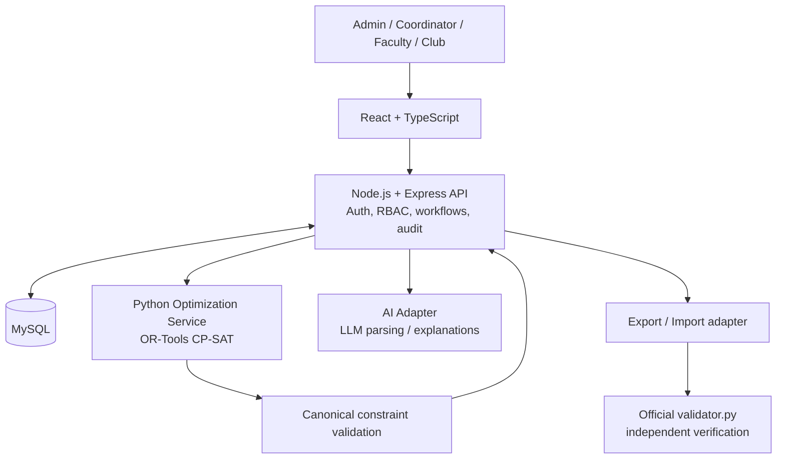

# 03 — Proposed Architecture & Engineering Decisions

## 1. Recommended architecture
**React + TypeScript frontend; Node.js + Express application API; MySQL system of record; Python optimization service using Google OR-Tools CP-SAT; optional LLM provider behind an isolated AI adapter.**

## 2. Why this architecture
- **Reuse team's strength:** React/Node/MySQL are familiar and fast for CRUD, auth, approvals, dashboards and integration.
- **Use the right tool for the hard problem:** CP-SAT is purpose-built for discrete constraint optimization. Python has a mature OR-Tools API and can directly consume the starter JSON.
- **Keep authority clear:** Node owns user-facing workflows and persistence; Python returns proposals; Node revalidates and controls approval/commit.
- **AI is replaceable:** LLM provider can fail or change without affecting manual booking, solver, approvals or validation.
- **Independent verification:** official `validator.py` checks the exported result; it is not embedded as a replacement for the application's own validation.

## 3. Service boundaries
### React client
- Authenticated application and role-specific navigation.
- Timetable views: group, faculty, room.
- Booking request form, editable AI extraction, conditional options.
- Schedule proposal diff and approval UI.
- Drag/drop or tap-to-move previews; never trusted for final validity.
- Dashboard, notifications, import/export controls.

### Node API (workflow authority)
- Authentication and server-side RBAC.
- Dataset lifecycle and validation orchestration.
- Schedule generation job orchestration and solver result intake.
- Booking decision workflow, approvals, cancellations.
- Disruption lifecycle, proposal versions, Admin approval and activation.
- Audit logs, notifications, exports and demo reset.
- Revalidate all writes before persistence.

### Python optimizer
- Parse/normalize dataset into domain model.
- Build CP-SAT models for timetable, exams and disruption repair.
- Produce candidate assignments and diagnostics.
- Provide deterministic `validate_assignment` / `validate_move` logic or call the shared canonical validation package.
- Never write directly to MySQL or approve/publish schedules.

### AI adapter
- Parse free text to strict JSON schema.
- Ask clarifying questions / expose uncertainty.
- Optional wording of code-generated explanations.
- Never directly call write endpoints or decide constraints.

## 4. Communication
Recommended for hackathon: synchronous internal HTTP between Node and Python for small calls, with background job IDs for long solver runs. A simple database-backed job table is adequate; Redis/queue is optional, not mandatory.
- `POST /internal/optimizer/timetable-jobs` → job ID.
- `GET /internal/optimizer/jobs/:id` → queued/running/succeeded/failed, progress, result reference.
- Python returns proposal payload; Node validates and stores it.
- Set timeouts, bounded payloads, retries only for idempotent reads/requests.

## 5. Data ownership and schedule lifecycle
- MySQL is operational system of record.
- Imported dataset is stored as immutable dataset version plus normalized relational records or canonical JSON snapshot.
- Solver output is a **proposal**, not the active schedule.
- Only a validated and authorized publish operation changes active schedule pointer.
- Keep baseline and proposed versions immutable. Activation is a transaction.
- Export files are generated from persisted application state, never hand-edited.

## 6. Recommended deployment topology
- Frontend static hosting or Node-served build.
- Node API service.
- Python optimizer service.
- MySQL managed or single-host instance with persistent storage/backups.
- LLM calls from server only; no provider key in browser.
- Health endpoints and logs for each service.

## 7. Architectural anti-patterns to avoid
- Implementing CP-SAT in React or relying on browser calculations.
- Allowing LLM to choose a room/time or mark a proposal valid.
- Having two separate implementations of hard rules that drift.
- Writing optimizer candidates directly into active schedule tables.
- Holding a DB transaction open during a long solver run.
- Assuming public dataset IDs/counts are fixed; judges may load other data/change files.
- Overengineering with microservices, Kafka, Kubernetes or Redis unless actual load/time justifies it.

## 8. Core engineering decisions
| Decision | Choice | Rationale |
|---|---|---|
| Frontend | React + TS | Familiar, fast, typed contracts |
| Main API | Express | Team fluency and workflow orchestration |
| DB | MySQL | Existing team capability, relational integrity |
| Solver | Python + OR-Tools CP-SAT | Constraint optimization fit |
| AI | Provider-agnostic adapter | LLM failure isolation |
| Schedule writes | Versioned + transactional | Rollback and approval safety |
| Validation | One canonical rule module + official validator in CI/manual QA | No divergent rules, independent scoring |
| Job handling | DB-backed job state initially | Avoid infrastructure overhead |
