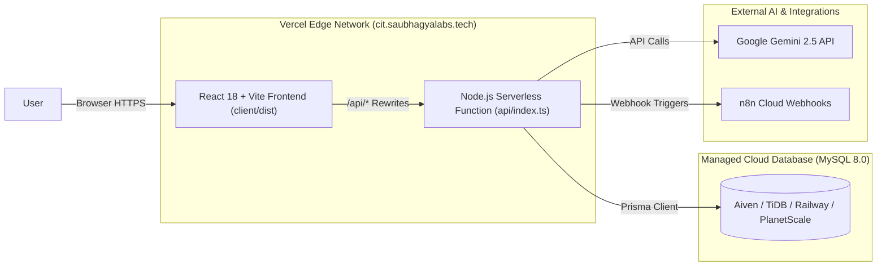

# 🚀 Complete Vercel Migration & DigitalOcean Decommissioning Guide

**Target Domain:** `https://cit.saubhagyalabs.tech`  
**Target Platform:** Vercel (Frontend SPA + Node.js Serverless Functions)  
**Database Backup:** Saved locally & committed at `exports/cit_campus_os_backup.sql`  

---

## 🏗️ Architecture on Vercel



---

## 📋 Step-by-Step Migration Checklist

### Step 1: Database Provisioning (Replace Droplet MySQL)
Since Vercel is a stateless serverless platform, MySQL must be hosted on a cloud database provider. Any of these free/instant MySQL options can be used:

1. **Option A: TiDB Cloud (Recommended - 100% Free Serverless MySQL)**
   - Go to [tidbcloud.com](https://tidbcloud.com) and create a free Serverless Cluster (no credit card required).
   - Click **Connect** and copy your Prisma MySQL connection string:
     ```env
     DATABASE_URL="mysql://<username>:<password>@<host>:4000/cit_campus_os?sslaccept=strict"
     ```
   - Import the backup: Run `mysql -h <host> -P 4000 -u <user> -p cit_campus_os < exports/cit_campus_os_backup.sql` (or run `npx prisma db push` and `npm run seed`).

2. **Option B: Aiven for MySQL (Free Tier)**
   - Go to [aiven.io](https://aiven.io) and launch a free MySQL service.
   - Copy the `Service URI` into `DATABASE_URL`.

---

### Step 2: Import Project into Vercel

1. Log in to your [Vercel Dashboard](https://vercel.com).
2. Click **Add New...** ➔ **Project**.
3. Import your GitHub repository: **`Akshat-sin-official/TZ-Meru-Byte`**.
4. Vercel will automatically read `vercel.json` and `package.json`:
   - **Framework Preset:** Vite
   - **Root Directory:** `./` (Leave as root)
   - **Build Command:** `npm run build`
   - **Output Directory:** `client/dist`

---

### Step 3: Configure Environment Variables in Vercel

Under **Project Settings ➔ Environment Variables**, add:

| Variable Name | Value | Purpose |
| :--- | :--- | :--- |
| `DATABASE_URL` | `mysql://...` *(from Step 1)* | Database connection for Prisma |
| `JWT_SECRET` | `cit-campus-os-super-secret-jwt-key-2027` | Session tokens for authentication |
| `GEMINI_API_KEY` | *(Your Gemini API Key)* | Natural language booking & explanations |
| `N8N_BASE_URL` | `https://techzephyr.app.n8n.cloud` | n8n Cloud Webhooks |
| `NODE_ENV` | `production` | Production mode |

Click **Deploy**! Vercel will build the Vite frontend and the serverless API.

---

### Step 4: Point Domain (`cit.saubhagyalabs.tech`) to Vercel

To keep the URL identical without changing anything for judges or users:

1. In Vercel Project Settings ➔ **Domains**:
   - Add domain: `cit.saubhagyalabs.tech`.
2. In your DNS Provider (Cloudflare, GoDaddy, Namecheap, etc. for `saubhagyalabs.tech`):
   - Find the existing `cit` record (which currently points to DigitalOcean IP `64.227.177.47`).
   - Change it to:
     - **Type:** `CNAME`
     - **Name:** `cit`
     - **Target:** `cname.vercel-dns.com`
     *(Or if using an A record, change IP to `76.76.21.21`)*.
3. Vercel will verify the DNS record and automatically issue a free SSL certificate within 1–2 minutes!

---

### Step 5: Decommission the DigitalOcean Droplet

Once `https://cit.saubhagyalabs.tech` is verified working on Vercel:
1. Log in to [DigitalOcean Cloud Console](https://cloud.digitalocean.com).
2. Select droplet `tz-meru-byte-ubuntu-2v-2gb` (IP `64.227.177.47`).
3. Click **Destroy** ➔ **Destroy this Droplet**.
4. Confirm droplet termination.

